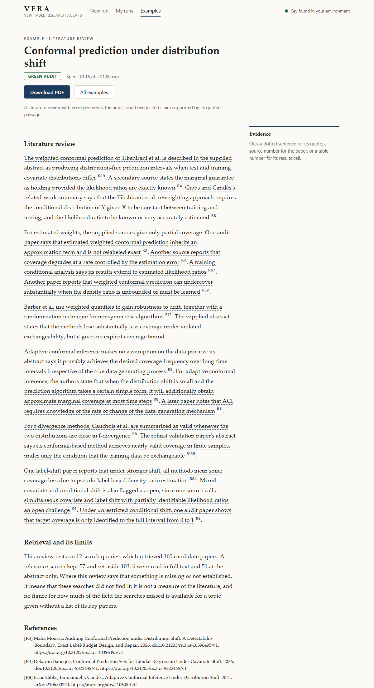
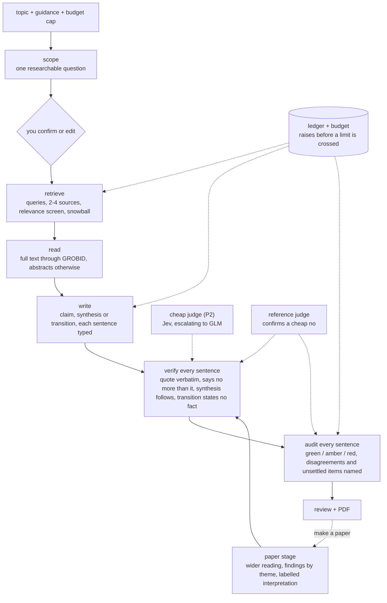

# VERA — literature reviews and review papers you can check sentence by sentence, on your own key

**VERA** stands for **V**erifiable, **E**conomical **R**esearch **A**gents: research agents whose output can be checked
claim by claim (verifiable) and that run cheaply on the user's own key (economical).

**Status: v1.0, closed, portfolio project.** Built in eleven gated increments (2026-09-29 to 2026-10-15) and closed on
2026-10-15. A local app takes a topic to a confirmed question, a literature review in which every claim is tied to an exact
quote, and on request a review paper, all on the user's own model key within a cap the user sets; an audit then checks every
sentence and says, in a colour and in words, what it could and could not confirm. The headline is mixed and reported in full:
the checks catch planted faults (50 of 52) and most real defects that earlier checks missed (15 of 21 on 90 real items), but no
cheap judge met the 97% agreement bar against a reference judge (89%, 95%, 89%), independent readers still find claims that
say a little more than their quotes, and **making the checks stricter did not make the papers measurably better**
([Results](#results), [Limitations](#limitations), [retrospective](docs/reviews/retrospective.md)).

**▶ Read-only showcase: [pcschmidt.github.io/VERA](https://pcschmidt.github.io/VERA/)**: nine finished examples with their
evidence panel, the exact inputs behind each, and a PDF of each; six of them also carry the review paper made from the
review, shown with the light its own audit gave it (three red, two amber, one green that later checks turn red) and the
deficiencies found in it. Nothing on that page runs a model or asks for a key.

<div align="center">



</div>

*The reader. Every cited sentence is dotted; clicking one opens the exact quote it rests on and where in the source it sits,
clicking a source number opens the paper, and the audit result is stated in plain words under the text. The same document
downloads as a PDF with every claim and its quote in an appendix.*

## What is this? (plain-language overview)

VERA (Verifiable, Economical Research Agents) asks one question: *can an AI research assistant be made cheap enough to use,
and checkable enough to trust?* Autonomous research agents now write papers that clear automated review bars. Two gaps follow:
almost nobody can afford to run them, and nobody independent checks whether what they write is true. VERA addresses both with
three layers: a cheap-by-default **judge** (P2), an **auditor** that checks citations, numbers and claims (P1), and a **research
agent** (P3) that takes a topic and writes under a hard budget.

> Topic → one confirmed question → search → read → write with quotes → **audit every sentence, and say what the audit cannot show.**

You give it a topic. It proposes **one** research question and waits for you to confirm or edit it. It then searches several
paper databases, reads the most relevant papers (in full text where it can), and writes a review in which every sentence is one
of three kinds: a **claim** tied to an exact quote, a **synthesis** that names the claims it rests on, or a **transition** that
states no fact. On request it turns the review into a **review paper** with method, findings by theme, threats to validity, and
discussion and conclusions boxed as interpretation. A second mode, from the command line only, reproduces a published method's
baseline in a sandbox and tries new ideas against it.

What makes it more than a summarizer:

- **Every sentence has a status, and is checked by a judge that did not write it.** A claim must be verbatim in its source and
  say no more than its quote; a synthesis must follow from the claims it names; a transition must state no fact. A sentence that
  fails is repaired once or removed, and the audit checks every sentence again.
- **The light says what it means.** Green, amber and red are defined below; "judges disagree" and "unsettled" are reported as
  such instead of being turned into a false pass or a false failure.
- **Your key, your money, bounded.** Every model call is charged to the key you connect and goes through a budget that stops
  the run before your cap, keeping what was done. The key is held in memory and written nowhere; a test has the provider echo
  it back and checks it appears in no file, status or message.
- **Measured, and reported as it came.** Every check that a result rests on was measured on a set frozen before its one test run,
  and each increment's review states what fell short.

### Who it is for, and when it earns its place

| If you are... | VERA gives you... |
| --- | --- |
| starting on an unfamiliar research question | a scoped question and a quoted, checkable review in about 10 minutes for about 15 cents |
| reading AI-written research | a worked example of tying every sentence to evidence and saying plainly what was not checked |
| building research agents | a pattern: cheap judges that escalate, audits that never grade their own producer, budgets that raise |
| evaluating judge models | real benchmark sets and the measured gap between cheap judges and a reference |

It is a poor fit if you need a complete or systematic review (retrieval finds about 60% of key papers on measured topics), a
verdict on whether a field's conclusions are right, or results you can cite without reading the quotes yourself.

### Why check every sentence, and not just the citations?

Increment 5 showed reviews with every citation real and every claim supported still carrying a sentence that said more than its
quote, or an uncited sentence that was simply wrong. A citation check cannot see either. Checking every sentence by kind is the
only way a green light can mean something about the text a reader actually reads.

## At a glance

| | |
| --- | --- |
| Input | a topic, optional guidance, and a dollar cap |
| Output | a literature review and, on request, a review paper; each with its audit and a PDF with every claim and its quote |
| Models | Claude Sonnet 5.5 writes (via OpenRouter); GLM-5.3 Flash judges, Jev answering first when its key is set; Claude Sonnet 5.5 is the reference judge that confirms a cheap "no" on claims and statements |
| Sources | arXiv and Crossref keyless; OpenAlex and Semantic Scholar with your own keys |
| Cost and time | $0.11 to $0.21 and 7.5 to 15 minutes per review; $0.53 to $0.77 per review paper, in this project's runs |
| Measured: audit on planted faults | 50 of 52 caught on a frozen-source test; 3 of 6 clean controls failed (two for real misstatements) |
| Measured: sentence checks on real defects | 15 of 21 faulty items flagged (old checks: 0), 14 of 69 sound items flagged, on 90 real items against an AI assistant's labels |
| Measured: cheap judge against the reference | 89% (claims), 95% (sentences), 89% (statements) agreement on 162 real items; the 97% bar is not met |
| Stack | Python 3.11, LangGraph, Pydantic v2, FastAPI, plain HTML and JavaScript, fpdf2, GROBID in Docker (optional) |
| Tests | 855 (`uv run pytest -q`, about 3 minutes; 13 need Docker), with offline fakes for every model call |
| Spend for the whole project | $16.05 of model calls over 16 days, inside a $20 monthly ceiling (`data/results/spend_total.json`) |

## Architecture at a glance



The app is a thin layer over the same pipeline: a run is a worker process started with the key in its environment; the live
view reads the run's own ledger, gate and audit files and computes nothing the run did not record. Stop is a file the next model
call notices; resume restarts from the last checkpoint without repeating paid work.

## Quickstart

### 0. Just look (nothing to install)

Open [pcschmidt.github.io/VERA](https://pcschmidt.github.io/VERA/) and read an example: click a dotted sentence for its quote, a
source number for the paper, press **Download PDF**.

### 1. Run the app (Python 3.11+ and [uv](https://docs.astral.sh/uv/))

```bash
git clone https://github.com/PCSchmidt/VERA.git
cd VERA
uv sync
uv run vera-app
```

Open <http://127.0.0.1:8765>, press **Connect my key**, paste an OpenRouter key (your OpenRouter account, under Keys, with a small
credit) and start a run. Define acronyms and new terms in the topic box: the proposal is only as good as the topic. On a
finished review, **Make a paper from this review** writes the review paper.

Optional: GROBID in Docker on port 8070 (`docker run --rm -p 8070:8070 lfoppiano/grobid:0.8.2`; on WSL2 add
`-e JAVA_TOOL_OPTIONS=-XX:-UseContainerSupport`) lets VERA read full texts; without it, it reads abstracts and says so. A
`SEMANTIC_SCHOLAR_API_KEY` or `OPENALEX_API_KEY` in a `.env` file widens the search.

**Which models it uses.** There is no model choice in the app: the one OpenRouter key pays for all three.

| Role | Default model (OpenRouter id) | Set in |
| --- | --- | --- |
| Writer: proposes the question, writes the review and the paper | `anthropic/claude-sonnet-5.5` | `vera/app/pipeline.py` (`DEFAULT_MODEL`) |
| Cheap judge: answers every check first | `z-ai/glm-5.3-flash` | `vera/judge/cheap_path.py` |
| Reference judge: confirms a cheap "no" on a claim or an interpretation statement before it can fail | `anthropic/claude-sonnet-5.5` | `vera/judge/cheap_path.py` (`CONFIRM_NO`) |

- **Change the writer** with `VERA_GENERATOR_MODEL=<OpenRouter model id>`, set in the shell before `uv run vera-app`
  (PowerShell: `$env:VERA_GENERATOR_MODEL = "..."`). It is read from the environment only, not from `.env`. No other writer was
  measured; the costs above are for the default.
- **Add Jev** (TypeSafe's decision model, [below](#the-cheap-judge-jev-a-decision-model)) as the first cheap judge with
  `TYPESAFE_AI_API_KEY` in `.env` (the environment works too): Jev answers first and GLM takes anything below 0.7 confidence.
  Without it, GLM answers every check alone.
- **The two routes were measured** against the reference on 162 real items (Increment 8, `data/results/judge8_test.json`):
  Jev then GLM agreed on 89% (claims), 95% (sentences) and 89% (statements); GLM alone, the default for a new user, on 86%,
  93% and 87%. Neither meets the 97% bar. The judges cannot be changed without editing the code.

### 2. Run the tests

```bash
uv sync --group dev --group bench --group corpus
uv run pytest -q          # 855 tests, offline, no keys needed (13 need Docker)
uv run ruff check .
```

### 3. The research loop and the measurements (command line)

Each script's docstring says what it needs and what it costs: `scripts/run_loop.py` (the research loop), `scripts/run_topic.py`
(the literature stage), `scripts/run_seeded_v3.py` (the audit's planted-fault test), `scripts/measure_realcase.py` (the sentence
checks on real items), `scripts/measure_judge8.py` (the cheap judge against the reference).

## Approach: why it is built this way

- **Gates, not hope.** Work was built in increments under the [Meridian](docs/meridian-dogfood.md) harness: a SPEC the owner
  approves, automated gates that re-run the tests and checks, human gates only the owner passes, and an independent Evaluator
  (a fresh model that did not write the work) that must pass each increment's review.
- **No self-grading.** A component never issues the verdict on its own text; the judge is never the producer.
- **Frozen before tested.** Every measured set and the code it measures are hashed before the one test run; a later change
  spends the set. (The rule was broken once, in Increment 4, and the review says so.)
- **Cheap by default, measured.** The judge asks small questions of a cheap model first and escalates when unsure; where that is
  not good enough (Increment 8), a reference judge confirms the cheap judge's "no" before anything fails.
- **Honest by construction.** Seeded faults, real-case sets and controls test the checks; independent readers test the output;
  each review lists what fell short.

### The cheap judge: Jev, a decision model

Most of VERA's checks are small typed questions: does this claim say more than its quote (yes or no)? Is this paper relevant
(pick one)? How well does this sentence follow (a score)? A chat model answers those by writing text, which then has to be
parsed, and any confidence it gives is a number it writes about itself. **Jev** is built for this kind of question instead.
TypeSafe describes it as its flagship model and "the first System One model", a class of models "built to make fast, structured
decisions that software can use directly": "No text generation, no parsing"
([TypeSafe docs](https://docs.typesafe.ai/introduction)). It takes the material (the *state*) and a batch of typed questions
(true or false, choose an option, score on a rubric), evaluates each "in parallel and in isolation against the same state", and
returns a **probability for each possible answer**, not prose ([`vera/backends/typesafe.py`](vera/backends/typesafe.py)).

Jev is also very new. TypeSafe released it on 15 September 2026; by 9 October the company had raised $870 million at a
$7.5 billion valuation and said a third of Fortune 500 companies were already using the model
([TechCrunch](https://techcrunch.com/2026/10/09/the-maker-of-non-text-ai-model-jev-valued-at-7-5b-just-weeks-after-launch/)).
VERA benchmarked it on 1 October, about two weeks after its release, and has used it as the first judge since. The figures
below are this project's own measurements, not the vendor's.

That shape is what a cheap-first judge needs:

- **The confidence is the model's own probability**, so the router can trust it to decide when to escalate: VERA sends anything
  Jev answers below 0.7 to GLM-5.3 Flash. On the Increment 1 benchmark Jev's calibration error was 0.008; the local model
  that reports its own confidence said 1.0 on 1,149 of 1,150 verdicts, so its errors could never escalate.
- **No parsing, no malformed answers**: none in the Increment 8 measurement.
- **Fast and cheap.** Priced on input only ($0.042 per million input tokens, output free): about $0.00005 per item, 1.3% of the
  reference judge's cost, with a median of 0.19 s against GLM's 1.95 s and Sonnet's 1.26 s (Increment 1, [T1](docs/04-trade-studies.md)).
  Many questions go in one metered call.

What it does not do, measured: on the Increment 1 benchmark Jev alone agreed with the reference on 97.0%, and its few errors
on the research loop's gate decisions were confident ones escalation cannot catch, so those questions go straight to GLM. On
Increment 8's harder sentence-check questions Jev alone agreed on 79% (claims), 93% (sentences) and 77% (statements) and was
unsure on about half the claims and statements; escalating those to GLM gives the best route measured (89%, 95%, 89%), still
below the 97% bar. Jev needs its own TypeSafe key; without one VERA uses GLM alone. Under TypeSafe's terms VERA never trains
on Jev's output.

## Motivation

Autonomous research systems such as ScientistTwo generate papers at about $3,800 and two to three days per task. VERA set out to
see how far a cheap, budget-bound pipeline could go, and how much of what it writes can be checked automatically. It is the
portfolio's "probabilistic components propose, deterministic gates decide" idea applied to research writing: the model writes,
but every sentence must pass a check it did not write, and the light reports exactly what passed.

## Method (what the pipeline actually does)

1. **Scope.** The topic becomes one researchable question with a stated reason; a check rejects one that is not specific enough,
   and you confirm or edit it before anything more is spent.
2. **Retrieve.** Twelve queries go to arXiv and Crossref (and OpenAlex and Semantic Scholar with keys); records are merged, a judge
   screens them for relevance, and kept papers' reference lists seed a snowball step.
3. **Read.** The top papers are read in full text through GROBID, the rest at the abstract; the reading report says which.
4. **Write and verify.** The writer types every sentence. Claims: the quote must be verbatim in its source, a quote that opens with
   a back-reference is widened to the sentence before it, the judge must say the passage supports the claim, the quote alone states
   it, and the claim says no more than it. Synthesis: premises must exist, two sources are needed to speak of agreement, and the
   judge must say it follows. Transitions: the judge must say they state no fact; statements about what the evidence lacks are
   removed. A cheap judge's "no" on claims and statements is confirmed with the reference judge; a failure is repaired once, then
   removed.
5. **Paper (on request).** Wider reading (up to 15 papers in full), findings by theme, method and threats written from the run's
   files, and interpretation sections whose every statement names the claims it rests on and is judged to follow from them.
6. **Audit.** Citations exist; every sentence is checked again by kind; a "no" on a claim or statement is confirmed with the
   reference, reusing its write-time answer when the text is unchanged; the result is a colour with every finding listed.

The experiment mode (command line) reproduces a parent paper's baseline in a Docker sandbox, has the model propose and implement
ideas, runs them on subsets and writes a paper whose every table cell and figure the audit checks against `results.json`.

## What the audit light means

The light is a floor, not a verdict. It says exactly this:

- **Green**: no check failed and there is nothing to read. Every citation exists; every claim was judged, with confidence, to be
  supported by and say no more than the passage it quotes; every synthesis and interpretation statement to follow from the claims
  it names; every other sentence to state no fact. No judge said a confident "no" and none was unsure.
- **Amber**: no check failed, but there are warnings to read:
  - a **judge disagreement**: the audit's judge said a confident "no" and a confident "yes" stands against it, from the reference
    judge (asked to confirm a "no" on claims and statements) or recorded when the sentence was written;
  - an **unsettled** item: the reference judge was asked and answered below 0.7 confidence, either way;
  - a judge **unsure** (below 0.7) on any check; the reference is asked only after a confident "no", so an unsure cheap judge on
    a claim or statement is amber without it;
  - a quote that opens with a back-reference ("this", "however, this ..."), so what it is about is outside it;
  - in a document made before sentence statuses existed, a claim-free sentence that states a fact and was judged to follow from
    its section's claims without naming them;
  - a lead for a person (method and novelty notes).
- **Red**: at least one deterministic rule failed (a citation that does not resolve, a quote not in its source, a source named
  without a claim, a statement about what the evidence lacks), or a judge failed an item with a confident "no" that nothing
  overrules: on claims and statements the reference confirmed it with a confident "no" of its own; on other checks no confident
  "yes" was recorded against it.

**No colour, green included, means** that the review is complete, that retrieval found the important papers, that the reading of the evidence is
right, or that a claim is true beyond what its quote says. The judges themselves fall short of the 97% agreement bar on claims
and statements (Increment 8), and independent readers still find claims that say a little more than their quotes in documents
the audit passed. Green does not mean correct. Read the quotes.

## Results

Full tables with run ids and caveats are in [`docs/reviews/`](docs/reviews/) (one per increment) and
[`docs/results/`](docs/results/); the [retrospective](docs/reviews/retrospective.md) summarises them.

| Question | Result |
| --- | --- |
| Can the judge be cheap? | For the loop's decisions, yes: about 1 to 2% of the reference judge's cost at matching decisions (Increment 1); 150 of 150 gate decisions agreed, **but 136 are perturbed copies** (Increment 5) |
| Does the audit catch planted faults? | 50 of 52 on a frozen-source test (96%, 87 to 99%); **3 of 6 clean controls failed**, two because the papers really misstated the reproduction basis |
| Is a green audit enough? | **No.** From Increment 5 on, independent readers found claims saying more than their quotes and wrong uncited sentences in green documents; this is what Increments 7 to 9 addressed |
| Do the sentence checks catch real defects? | On 90 real items from Increment 6's papers: old checks 0 of 21 faulty items, new checks 15 (claims 4 of 5, sentences 11 of 14, statements 0 of 2), with 14 of 69 sound items flagged; labels by an AI assistant, not a person (Increment 7) |
| Are the new judge questions reliable? | **Not to the bar.** On 162 real items against the reference: 89% claims, 95% sentences, 89% statements (97% needed); the reference itself is unsure on about a fifth of claim and statement verdicts (Increment 8) |
| Did stricter checks make better papers? | **Not shown.** Re-audited, Increment 6's papers turn red; papers made with each new layer are not better by the audit (Increment 9: 0 to 1 and 1 to 2 failures, one run each) or by an independent reader (Increment 7: 4 and 5 overstated claims per paper against 3 to 6 before) |
| Does retrieval find the key papers? | 59% of key papers over six topics before the screen; 64% with Semantic Scholar. Retrieval remains the weakest stage |
| Did the research loop beat a baseline? | **No**, on either parent problem (TreeHFD; credal ambiguity sets) |
| Versus ScientistTwo (MOE-3) | Not met: the gain half fails and ScientistTwo's per-run cost is not published |
| Is the output good? | Blind scores out of 5: reviews 4.27 (builder) and 2.93 (independent scorer) in Increment 5; papers 3.94 and 3.17 in Increment 6, with the paper preferred to its review in five of six judgements |
| Can a new user use it? | **Not shown.** The one walkthrough was the builder |

## Limitations

- **No independent user, and no person's labels since Increment 6.** MOE-4 is not shown; the Increment 7 and 8 reference labels and
  first scores came from an OpenAI assistant at the owner's request, stated in each review.
- **The judges are below their bar.** The cheap judge agrees with the reference on about 89% of claims and statements; the reference
  is unsure on about a fifth. The audit names disagreements and unsettled items, but a confirmed "no" is still one model's view.
- **The write step has a blind spot.** It asks the reference only when the cheap judge says no; a claim the cheap judge passes at
  write time meets the reference first in the audit (two of Increment 9's three remaining failures).
- **One run per paper.** No change was measured against run-to-run variance.
- **Retrieval misses papers** (about 40% of key papers on measured topics), and reviews lean on abstracts unless GROBID runs.
- **Experiments are not in the app**, and the loop has not beaten a baseline.
- **Same-family grading.** The writer, the reference judge and the independent scorers are Claude models; the cheap judges are not.
- **One builder, one machine.** Exercised on Windows with Python 3.11; the showcase build also runs on Linux in CI.

## Known gaps against the original roadmap

The project began with a plan for three products and a larger scope. These parts were **not built**; the results above say nothing
about them.

- **P1 on external papers**: PDF ingest, claim extraction, leakage checks and re-runs on other people's papers, and a batch audit of
  the ScientistTwo corpus. Planned from the start as optional, moved later at each re-plan, and marked not planned at the close.
- **Experiments from the app**: the research loop runs from the command line only.
- **The portfolio papers** (a judge benchmark and an independent audit of an AI-generated corpus).
- **The not-planned list at the close**: asking the reference about every claim, multi-run measurement, a person's labels or a vote
  of strong judges, and the claim-level misses Increment 7's scorer found; each with the reason it was left in
  [docs/07-increments.md](docs/07-increments.md).

## Operational notes

### What runs where

| Piece | Where |
| --- | --- |
| The app and the pipeline | Your machine (Python, `uv`); the server answers only `127.0.0.1` |
| Model calls | OpenRouter, charged to your key; Jev (TypeSafe) with its own key if set |
| Paper search | arXiv, Crossref, and OpenAlex or Semantic Scholar if you supply keys |
| Full-text reading | GROBID in Docker on your machine (optional) |
| The experiment sandbox | Docker on your machine (command line only) |
| The showcase | GitHub Pages, static files built from committed examples |

### Data and keys

No maintainer key is in the repository, any build artifact or any log; `tests/test_no_secrets.py` and `tools/checks/check_app.py`
scan for key-shaped strings, and the app never falls back to a key that is not yours. Keys in a git-ignored `.env` are read from
your environment. Third-party PDFs (the ScientistTwo corpus, papers read for reviews) are stored locally and never committed; runs
and caches are git-ignored. See [`data/README.md`](data/README.md).

### Verify the claims (a reviewer's path)

```bash
uv run pytest -q                                          # 842 passed, 13 skipped without Docker
python tools/checks/check_app.py --part secrets           # no key-shaped string, local-only server, no external loads
python tools/checks/check_carry5.py                       # frozen audit files unchanged since Increment 5 was scoped
uv run python tools/checks/check_carry7.py --part measured   # the real-case measurement ran once, after its freeze
uv run python tools/checks/check_carry8.py --part measured   # the judge measurement ran once, after its freeze
uv run python scripts/reread9.py                          # Increment 8's re-audits re-read under Increment 9's rule, no model call
uv run python scripts/reread10.py                         # Increment 9's papers re-read with the write-time answer kept
uv run python scripts/spend_total.py                      # the project's model spend from every ledger, deduplicated
bash scripts/gate-engine.sh current                       # where the build stands, gate by gate
```

Then open any example on the showcase and click a dotted sentence: the quote and its place in the source are the evidence. Each
increment's review ends with the Evaluator's verdicts, kept unedited in `.meridian/evaluator/`.

### Documentation map

| Doc | What it covers |
| --- | --- |
| [docs/reviews/retrospective.md](docs/reviews/retrospective.md) | the whole project in two pages: what was built, measured, never shown, spent, and why it stopped |
| [docs/reviews/](docs/reviews/) | the review of each increment (0 to 10), with the Evaluator's rounds |
| [docs/07-increments.md](docs/07-increments.md) | the increment plan, each increment's result, and the closed not-planned list |
| [docs/01-conops.md](docs/01-conops.md) | users, scenarios and measures of effectiveness (MOE-1 to MOE-4) |
| [docs/02-requirements.md](docs/02-requirements.md) | requirements with their verification methods (v0.11) |
| [docs/03-interfaces.md](docs/03-interfaces.md) | the data contracts (schemas v0.13) |
| [docs/04-trade-studies.md](docs/04-trade-studies.md) | design decisions T1 to T11, each with a decision and a reverse-if |
| [docs/05-risk-register.md](docs/05-risk-register.md), [docs/06-verification-plan.md](docs/06-verification-plan.md) | risks, and how each kind of claim is verified |
| [docs/results/](docs/results/) | measured results: audit tests, retrieval recall, protocol runs, rubric sheets, the external review |
| [docs/meridian-dogfood.md](docs/meridian-dogfood.md) | what building VERA showed about its build harness |
| [CLAUDE.md](CLAUDE.md), [SPEC.md](SPEC.md), [CONTRACT.md](CONTRACT.md) | working instructions, the last increment's spec, the scope contract |

## Glossary

| Term | Stands for | What it means here |
| --- | --- | --- |
| VERA | Verifiable, Economical Research Agents | This project |
| P1 / P2 / P3 | — | The auditor, the judge library and the research agent |
| Claim / synthesis / transition | — | The three kinds of sentence: tied to a quote; relating named claims; stating no fact |
| Cheap judge | — | Jev, escalating to GLM-5.3 Flash when unsure: answers most checks at low cost |
| Reference judge | — | Claude Sonnet 5.5 as a judge: confirms a cheap "no" on claims and statements, and is the yardstick in measurements |
| Judge disagreement | — | One judge said yes and the audit's judge said no; reported as a warning (amber) |
| Unsettled | — | The reference judge was unsure (below 0.7) either way; neither a pass nor a failure (amber) |
| Interpretation | — | Discussion, conclusions and research agenda in a paper: each statement names its claims and is judged to follow from them |
| MOE | Measure of Effectiveness | A project-level success measure (MOE-4: a new user completes a run) |
| BYOK | Bring your own key | The app uses the user's model key and money, never the maintainer's |
| Ledger | — | The append-only record of every model call and its cost |
| Seeded fault / control | — | A defect planted to test the checks / an unmodified document they should pass |
| Frozen | — | Hashed before its one test run, so the test measures what ships |
| ScientistTwo | — | A system that generates research papers; the research loop's comparison target |
| GROBID | GeneRation Of BIbliographic Data | The tool that reads a paper's PDF into text and references |
| OpenRouter | — | The service that routes model calls with a single key |
| Meridian | — | The gated build harness the project was developed with |
| Evaluator | — | A fresh model, not the builder, that scores each increment's review before it can pass |

## License

MIT (see [LICENSE](LICENSE)) for VERA's code and docs. It does not cover the ScientistTwo papers or any other third-party material
VERA reads; those are never committed. The bundled DejaVu fonts (`vera/app/fonts/`) keep their own licence beside them.

## Author

Chris Schmidt ([PCSchmidt](https://github.com/PCSchmidt)), built with Claude Code under the Meridian harness. Part of a portfolio on
evaluator-gated AI systems: probabilistic components propose, deterministic gates decide. Ideas and decisions are his; human gates
were approved in his terminal (two in Increment 7 by an assistant working for him, as that review states).
