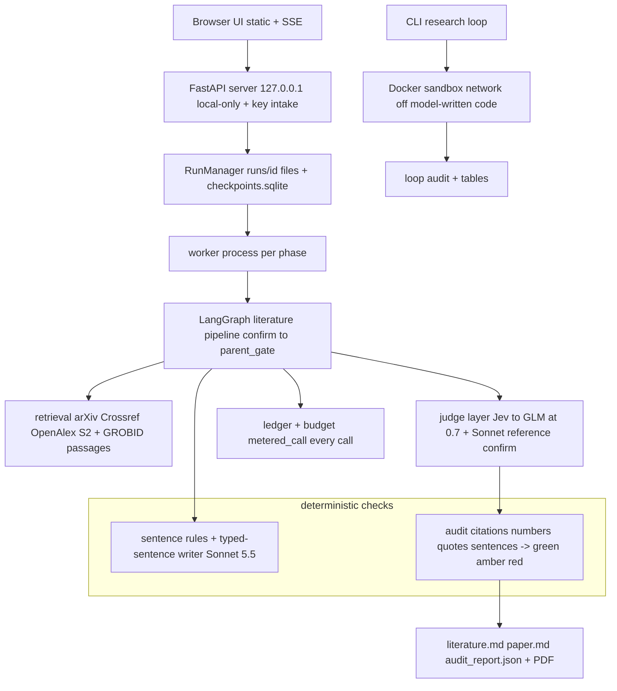
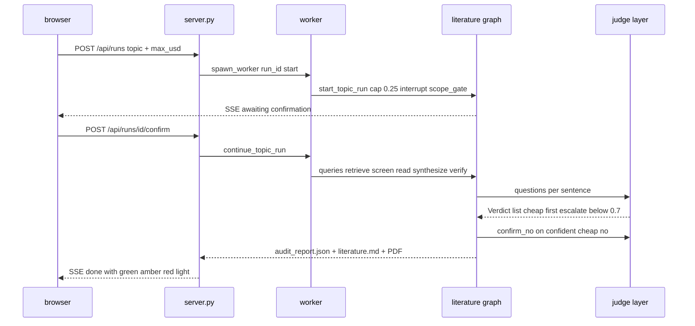

# VERA — Master Explainer

Repo: <https://github.com/PCSchmidt/VERA> (public) · Showcase: <https://pcschmidt.github.io/VERA> · MIT · Last commit `d7f484f` (2026-10-16)
Status: prototype-grade local app, "v1.0, closed" by owner decision 2026-10-15; post-close showcase work to 2026-10-16 [Documented] `docs/07-increments.md`, `docs/reviews/retrospective.md`
Generated 2026-10-18 by an AI agent under Chris Schmidt's direction · Questionnaire v1.2 · Depth: LITE (LITE run)

> **Assembly note.** Built from today's earlier passes on the same clean clone: `VERA.map.md` (Phase 1 + Part D), `VERA.part2A.md` (A–G), `VERA.part2B.md` (H–K), `VERA.part2C.md` (L–V), `VERA.part3W.md` (Part W register); §9 is the reviewed draft `VERA.math.md`. Load-bearing citations were re-verified against the clone here.

> **Tags.** **[Verified]** seen in code/config/tests/commits (cited `path:line`, function, SHA) · **[Documented]** stated in a committed doc or an earlier pass file (cited) · **[Author]** `AUTHOR_CONTEXT.md` ANSWER line (⚠ lines = [Inferred]) · **[Inferred]** reasoned · **[Proposed]** not in the repo · **[Unknown]** → §26. **This run performs no execution: nothing is [Measured];** numbers the earlier passes measured carry "map Mx / 2A / 2B / 2C" citations. §11 claim levels: **L1** doc matches artifact · **L2** re-run earlier · **L3** recomputed earlier · **NR** paid/one-shot. One fact, one home (CL-…, W-…, D-…, R-…).

## TL;DR

**V.1** VERA is a local, bring-your-own-key research assistant that turns a topic into a literature review (optionally a review paper) where every sentence is tied to a verbatim quote or marked connective, checked by cheap LLM judges with an expensive model confirming any "no", metered against a hard budget, and published with frozen-set measurements of where those checks fall short. [Documented] `VERA.part2C.md` TL;DR

**V.2** It serves independent researchers wanting a checkable first map for tens of cents, and engineers evaluating LLM judges (frozen sets, raw verdicts, negative results published). The interesting part is the discipline: 89 gates, an independent Evaluator whose failed rounds are kept, freeze hashes before every one-shot measurement, and a README stating its cheap judges miss their 97% bar, its loop never beat a baseline, and stricter checks did not improve papers. The limits are equally plain: no outside user has run it, every judge figure after Increment 6 is agreement with another model, the headline fault-detection figure is an upper bound (CL-02, W-EVAL-1), and the approval record names the owner for steps an assistant took (W-PROC-1).

## Repository fact sheet

| Field | Value | Tag / source |
| --- | --- | --- |
| Name · license | VERA ("Verifiable, Economical Research Agents"); package `vera`, app `vera-app`; MIT (bundled DejaVu fonts under own licence) | [Verified] `pyproject.toml:2,6-7,22` |
| One-line description | Local FastAPI app + CLI driving a LangGraph pipeline: topic → confirmed question → typed-sentence literature review (claim/synthesis/transition) checked by deterministic rules and cheap-then-reference judges → optional review paper → audit green/amber/red; plus a CLI research loop running model-written code in a Docker sandbox; every call metered and logged to JSONL | [Verified] `vera/app/pipeline.py:64-210` |
| Category · flags | AI app + research study `[AI]` `[AGENT]` `[MATH]` `[DATA]` `[API]` `[UI]` `[DEPLOY]` `[RESEARCH]` | [Inferred] |
| Size | 1,686 tracked files; Python 39,407 lines (`vera/` 13,884 · `scripts/` 9,596 · `tests/` 10,911 · `tools/` 4,186); `app.js` 758; ~99k words Markdown | [Documented] map M21 |
| Tests | 74 modules, 855 tests; earlier-pass `uv run pytest -q`: 851 passed, 4 skipped (Airfoil set), 0 failed, 186 s | [Documented] map M3/M21 |
| History | 240 commits, all authored "Chris Schmidt", `adefc9a` 2026-09-29 → `d7f484f` 2026-10-16 (18 days); one branch, no tags/PRs; 216 carry `Co-Authored-By` (140 "Claude Sonnet 5.5", 76 "Claude Opus 5.5"); 292,189 insertions | [Documented] map M18/M21 |
| Entry points | `vera-app` (`vera/app/server.py:403-412`), `python -m vera.app.worker <run_id> <phase>`, `scripts/run_topic.py`/`confirm_scope.py`/`run_loop.py`/`audit_topic.py`, `measure_*.py`, `build_pages.py`, `gate-engine.sh` | [Verified] |
| Clean clone / tests | Deps + offline suite pass (map M2/M3); app needs an OpenRouter key; loop needs Docker images and datasets not in the repo; several README "verify the claims" commands fail or overwrite tracked files (D-02, W-UX-1) | [Documented] map M2/M3/M15 |
| CI | `meridian.yml` = gate-DAG structure + gate-state consistency only (no tests/ruff, D-01); `pages.yml` deploys the showcase; both green on `d7f484f` | [Verified] `scripts/meridian-verify.sh:15,71-110` |
| Demo | Static showcase (9 examples, 6 with papers; 13 screenshots), HTTP 200 | [Documented] map M19 |
| External services | Paid: OpenRouter (writer+reference `anthropic/claude-sonnet-5.5`, cheap judge `z-ai/glm-5.3-flash`), TypeSafe "Jev"; free/keyed: arXiv, Crossref, OpenAlex, Semantic Scholar, GitHub API; local: GROBID Docker, Ollama (bench), Docker sandbox. Ceiling $20/month; spend $16.05 + $1.88 post-close | [Verified] `vera/bench/candidates.py:17-28`; [Documented] `retrospective.md` |
| AI coding tools | Claude Code (trailers, `.claude/` hooks/agents/skills); OpenAI ChatGPT/Codex acted for the owner in Increment 7 (labels, scores, two approvals) [Documented] `docs/reviews/incr-7.md:30,229-232`. [Author] adds GitHub Copilot + Prime-Agent — **no tracked evidence here** (§17) | [Verified]/[Author] |
| Related repos | Meridian (build harness; installed copies, `0d65c38`); sitework-ai = comparison baseline | [Documented] `docs/meridian-dogfood.md:3-9` |
| Headline claims | 34 audited in §11: 27 supported, 6 partial, 1 contradicted | §11 |

## 1. For everyone: what it does and why it matters (A)

**A.1 ★** A program you run on your own computer that turns a research topic into a short literature review — optionally a longer review paper — where every sentence is either tied to an exact quote from a real paper or marked as joining/introducing such quotes, then checks every sentence again and reports in a colour and in words what it could and could not confirm [Verified] `vera/app/pipeline.py:100-210`. **A.2 ★** AI-written research sounds right while citing papers that don't say what it claims; before this, people reviewed by hand or checked every citation themselves [Documented] README.md:30-36. **A.3** For independent researchers and students needing a first map for tens of cents: a two-page review with clickable quotes in ~10 minutes; the reader still reads the papers. No outside user yet (CL-18). **A.4 `[UI]`** One command; connect an OpenRouter key; type a topic and a dollar cap; confirm the one question VERA proposes; watch stages and spend (Stop/Resume); the result shows clickable quotes, source numbers and a PDF. **A.5 ★** Analogy: a newsroom fact-checking desk — the reporter may only file sentences quoting a source or connecting passed quotes; a junior checker reads each sentence and a senior must confirm any "wrong"; a clerk logs every call and the editor stops before the budget is crossed [Inferred] `cheap_path.py:38-42`. **A.6** The surprising part: it tells you what its green light does *not* mean — "a floor, not a verdict". **A.7** Information is live per run (arXiv, Crossref, OpenAlex, Semantic Scholar, OA PDFs via GROBID), cached without refresh. **A.8** Every claim shows its quote and the audit names its doubts, but the cheap checker agrees with the expensive one on only 89–95% of items and readers still found overstatements in passed documents. **A.9 `[AI]`** The AI proposes the question, writes queries and sentences, and answers hundreds of small yes/no questions; it does not decide whether a quote is really in the paper (text matching does), set the colour (a rule does), or run experiments. **A.10 ★** Can't: find all key papers (~60%), do a systematic review, judge whether a field is right, run without a paid key, or show stricter checks improve papers (they didn't). **A.11** Cost: your own key — ~$0.11–$0.21 a review, $0.53–$0.77 a paper; the project itself cost $16.05 (CL-13, CL-21). **A.12** The key stays in memory (tested); your topic and quoted passages do go to OpenRouter and the model's provider. **A.13/A.14** Built in 18 days by Chris Schmidt directing Claude Code; [Author] Q3: "Very little code written by Author… all development work done by LLMs and agents" — scope, ceilings, trades and freeze discipline his (§17). **A.15** To sell: real users, much better retrieval, simpler packaging, a judge meeting its own bar; the distinct offer is the sentence-level audit. **A.16 ★** If it vanished: portfolio readers and judge-evaluation researchers.

## 2. Purpose, problem, users, use cases (B)

**B.1 ★** Two stated gaps: readers cannot cheaply check an AI paper's claims and citations, and systems like ScientistTwo cost ~$3,800 and 2–3 days per task [Documented] docs/01-conops.md:8-16; as built, VERA solves the narrower sentence-visibility problem. **B.2–B.3** Motivation: that result plus a portfolio goal of measured systems [Documented]; [Author] Q6: defense-sector work makes these topics "relevant and of interest". Prior knowledge: applied mathematics and program work [Author]; learned in-project: bibliographic API limits, GROBID on WSL2, LangGraph checkpoints (docs/04). **B.4** Assumptions: cheap models make the small judgements — held for loop gates (97–100% at 1–2% of reference cost), **failed** for sentence checks (89/95/89% vs 97%); "green means trustworthy" failed. **B.6 ★** 58 requirement IDs (docs/02 v0.11); essential: every call ledgered (`metered_call`), checkpointed resume, budget never exceeded (strictly unmet — D-20), human-confirmed question ($0.25 cap), every sentence checked. **B.7** Non-functional: per-run cap ≤ $25, $20/month ceiling, judge p50 ≤ 0.5 s, flip rate ≤ 2%, key safety, offline tests. **B.8** Constraints: one Windows laptop [Author], keyless APIs by default, CPU-only. **B.9** Changed: Direction B (2026-10-01) made topic-to-paper the headline; external-paper auditing deferred then not planned; three scenarios not built. **B.10** Unmet: external-paper requirements, MOE-3/MOE-4, RSH-P-01 strictly. **B.11 ★** Primary user: independent researcher wanting a first map in ~10 minutes for ~$0.16; secondary: engineers evaluating LLM judges; edge case refused: treating green as proof. **B.12 ★** Use cases: quote-anchored review; paper from it; write-up audit; judge measurement on frozen sets (all working); outside-user walkthrough (not shown). **B.13** Journey: topic + cap → confirmed question → retrieval/screening → typed-sentence review → audit light + PDF. **B.14–B.15** Topic capped at 2,000 chars; the question gate and Stop/Resume stay human. **B.18 ★** Out of scope: systematic reviews, in-app experiments, external-paper auditing, hosting/accounts (docs/07). **B.19 ★** Measured: agreement, flip rate, ECE, seeded detection, recall, cost/latency; not: users, time saved, run variance. **B.20–B.21** User failure = trusting a green light that omits contradicting papers; "done" declared 2026-10-15. **B.22** The one full Meridian dogfood; sitework-ai is the comparison baseline [Documented]. **B.23** Government use would need approved endpoints, human labels, audit logging (§13).

## 3. Capabilities inventory (B.12, J.1)

**Working:** topic → confirmed question → retrieval (arXiv/Crossref/OpenAlex/Semantic Scholar + snowball) → screening → passage reading (GROBID PDFs or abstracts) → typed-sentence review with verbatim-quote anchoring → deterministic + judge checks → green/amber/red audit with per-sentence reasons; review-paper stage with boxed interpretations; PDF export; local app with BYOK, budget, Stop/Resume; CLI research loop with Docker-sandboxed model-written code; judge benchmark harness with frozen sets and offline replay; 89-gate Meridian harness with kept Evaluator verdicts [Verified] `vera/literature/graph.py`, `vera/app/`, `vera/loop/`, `vera/bench/`. **Partial:** sentence-level checks below their 97% bar (CL-04); retrieval recall 59–64% (CL-14); the seeded-fault claim as an upper bound (CL-02); resume repeating one node's spend (D-22). **Planned then not built:** external-paper auditor P1 (D-06), leakage/rerun checks, scenarios S2/S3/S5 (docs/07 "Not planned"). **Unverified:** any use by an outside person (CL-18).

## 4. Domain perspective (C)

**C.1 ★** Domain: evidence synthesis (reviews, bibliographic metadata, citations, full texts) + LLM evaluation; the sceptical practitioner is a systematic-review methodologist or research librarian. Models: `ScopedQuestion` ≈ a protocol question (no PICO), `SourceRecord` (no DOI or retraction field), `ClaimLink` (quote + locator), a claim/synthesis/transition taxonomy resembling argumentative zoning [Inferred] `vera/schemas/literature.py:36-129`. **C.2** Follows DOIs, arXiv ids, ISO 8601, GROBID TEI; ignores PRISMA 2020, BibTeX/CSL/RIS, ORCID, retractions [Verified]. **C.3–C.5** An expert would question: "Supported" means a model judged the claim says no more than one quoted span, not that the finding is sound; abstracts count as evidence; no source-quality appraisal, risk-of-bias or dual screening. **C.6–C.9** Sources: arXiv/Crossref keyless, OpenAlex/Semantic Scholar keyed, OA PDFs via GROBID 0.8.2; CS/ML-heavy coverage [Inferred]; provenance strong per claim (source key, quote, locator, URL, SHA-256) but cached answers carry no date. **C.10–C.12** Retrieval → screen → passage ranking → quote-constrained drafting → deterministic checks → judges with reference confirmation; uncertainty via the 0.7 cut and "unsettled" (§9). **C.13** Validated: BM25, Wilson, ECE; heuristics: 0.7, 0.97/0.90 cuts, `chars/3` estimates. **C.14** No practitioner review [Unknown → §26]. **C.15 ★** Not trustworthy for a real decision: needs recall ≳90% vs independent sets, human-labelled agreement, run variance; credible as a scoping aid [Inferred]. **C.17** Harm: a green review omitting contradicting papers could anchor a newcomer [Documented] docs/05 R12. **C.18** Publisher/API terms for caching and passage forwarding [Unknown]. **C.20** A sceptic asks first "how many important papers did it miss?" — ~40% of the builder's lists, unnamed [Documented] README.md:291,306.

## 5. Codebase guide (D)

**D.1 ★** `vera/` CORE (13.9k lines: `schemas/`, `ledger/`, `backends/` vendor HTTP only, `judge/`, `graph/`, `literature/`, `audit/`, `loop/`, `sandbox/`, `app/`); `tests/` 855 offline tests; `tools/checks/` 50 check scripts; `scripts/` 92 Python + ~70 gate wrappers (Meridian VENDORED, `0d65c38`); `docker/sandbox-*`; `data/` committed evidence; `docs/` 01–07 + 11 reviews + results; `.meridian/` 89 gates; `.claude/` hooks/agents/skills [Verified]. **D.2 ★** Entry points: `vera-app`, `python -m vera.app.worker`, `run_topic.py`/`confirm_scope.py`, `run_loop.py`, `audit_topic.py`, `measure_*.py` (`dev|freeze|test`), `build_pages.py`, `gate-engine.sh` [Verified]. **D.3 ★** Clone: `uv sync --group dev --group bench --group corpus`, `uv run pytest -q` (851 pass, 4 skip); app needs `OPENROUTER_API_KEY` [Documented] map M2/M3. **D.7 ★** Most important: `metered_call` (charge-then-call, ledger even on failure), `parse_answer`/`Router.ask` (malformed → confidence 0 → escalate), `cheap_path`, `verify_sentences` (`synthesis_stage.py:95-330`) + audit twin `check_entry`, `disagreement.outcome` + `overall_of` (the light), `sandbox.run_script`, `RunManager`/`SessionKey` [Verified]. **D.8 ★** `verify_sentences` captures the purpose: type each sentence; screen claim-free ones without a model; require claims to quote a retrieved source verbatim; judge meaning; confirm cheap "no"s; repair once then remove. **D.10/D.16** Fragile: freeze-locked files push new behaviour into reconcilers; `sticky.item_text` regex-coupled to prompt text; one question id with two wordings (D-12); string-coupled stop reasons; `run_audit`/`run_paper_audit` near-duplicates. **D.17 ★** 32 README/record discrepancies logged in §24; the load-bearing five: CI-without-tests, the reviewer path that rewrites evidence, the routing description, the unbuilt external auditor, `newuser_walkthrough`. **D.18** Highest value, hardest to replace: the judge layer + ledger + deterministic audit rules.

## 6. Tech stack and rationale (E)

**E.1 ★** Python ≥3.11 (3.12 resolved; README 3.11 vs CI 3.12 — D-09) for the LLM/ML ecosystem [Inferred]; plain HTML + vanilla JS (no build step, CSP `self`; choice reason [Unknown]); FastAPI + uvicorn (Increment 5; why [Unknown]); JSON/JSONL/Markdown files per run + SQLite checkpoints (T6: commit-able evidence). **E.3 ★** Load-bearing: Pydantic 2.13.5 (all contracts), LangGraph 1.2.12 + sqlite checkpointer (T2: tested resume — though both graphs are linear chains; a ~150-line runner would do [Inferred]), httpx, FastAPI/uvicorn, fpdf2 (LGPL) + DejaVu; optional pymupdf (AGPL). **E.4** Built in-house where libraries exist: retry, HTTP cache, `difflib` matching, a JS Markdown renderer (most debt-prone, CLAUDE.md:73-74), answer parsing [Inferred]. **E.5** Floors in `pyproject.toml`, hashed `uv.lock`; no vulnerability scanning (R-12/R-20); licences MIT/BSD except fpdf2 LGPL and pymupdf AGPL, unmentioned in README. **E.6** Lock-in low in code, moderate in evidence (price-routed unpinned aliases, W-STACK-1). **E.7** Isolation: uv + lock, Docker, freeze manifests. **E.8** Tooling: Claude Code on Windows, Meridian, Docker; formatter banned over `vera/` (freeze), ruff clean, no type checker. **E.9** Defense substitute [Proposed]: approved endpoints, on-prem judge, secret store, SBOM. **E.10** Debt: files as database, freeze-then-wrap, floor-only ranges [Inferred].

## 7. Architecture (F)

**F.1 ★** Local modular monolith with a process-per-job worker: FastAPI JSON API + static UI on 127.0.0.1; each run phase a detached Python process running a linear, checkpointed LangGraph pipeline that reports only through run-directory files; plus a CLI agentic loop whose model-written code runs in a Docker sandbox [Verified] `runs.py:1-8`, `worker.py:1-6`, `host.py:25-32`. **F.2 ★** Components: UI (SSE) · server (local-only guard, key intake) · RunManager · worker · pipeline · literature graph · judge layer · ledger + budget · audit · loop + sandbox · showcase builder. **F.3 ★** Trace: `POST /api/runs` → `RunManager.create` → `spawn_worker` → `start_topic_run` ($0.25 cap, `interrupt_after=["scope_gate"]`) → confirm → nodes confirm→…→synthesize→verify→parent_gate (`graph.py:36-48`) → `run_audit` → `artifacts/audit_report.json` [Verified]. **F.8 ★** Contracts: docs/03 v0.13 = `vera/schemas/*` (`Verdict` no-self-grading, `Budget.charge` raises, `extra="forbid"`); weak spot: the untyped run-file contract (INV-9/10, W-DATA-1). **F.11 ★** Invariants probed earlier (40 checks, 2A INV-1…13): core contracts hold; edge defects — dead worker or torn `app_state.json` strands a run (W-ARCH-1), NaN/negative costs and one-call overshoot (Low), duplicate question ids collapse in the router. **F.12–F.18** ~30 local API routes, no auth/rate limits, errors as `{"detail"}`; UI renders model text as text nodes, `http(s)`/`#` links only; a11y partial (`aria-live`, skip link; Space key gap, no axe) [Verified]. **F.19 ★** 10×/100×/1000×: paced HTTP + one GROBID container and unlocked caches break first; then the OpenAlex quota and per-second ledger re-reads; 1000× is not a target. **F.20–F.22 ★** Judge errors escalate, generator errors redact, GROBID-down falls back to abstracts; **SPOF: OpenRouter** (writer, cheap judge, reference on one key) and the run directory as sole copy. **F.24 ★** Decisions: 1 local-only BYOK app + showcase (T8) · 2 LangGraph + sync checkpoints (T2) · 3 Jev→GLM at 0.7 (T1, partly right) · 4 reference confirms cheap "no"s, write-time answers stick (T11, blind spot) · 5 ledger + gates.jsonl, no tracing (T6) · 6 files as state, no atomic writes/liveness (**needs fix**) · 7 freeze-then-wrap (reproducible but spread) · 8 network-off Docker sandbox (T4) · 9 GROBID + keyless-first retrieval (T3/T5; recall 59–64% is the weakest stage) · 10 Sonnet 5.5 writes every stage and is the reference judge (T9; writer = reference is incidental and worth reversing) [Inferred]. Most leverage: `metered_call` + `Budget`; most burden: freeze-then-wrap; reverse today: #10, #6.

## 8. Data architecture (G)

**G.1 ★** Plain files per run (JSON/JSONL/Markdown) + SQLite checkpoints + disk caches; no DB server, no vector store — so results commit as evidence (T6). Example run: 160 retrieved records (288 KB), 195 passages, 21 claims, a 510-row ledger [Verified] `data/paper_demo/…`. **G.3 ★** Run-file contract: `app_request.json`, `app_state.json`, `scope.json`, `retrieved.jsonl`, `passages.jsonl` (R10-P3), `claims.jsonl`, `sentences.jsonl`, `gates.jsonl`, `artifacts/`, `audit_report.json`, `checkpoints.sqlite`, `STOP`, `worker.log`; `paper/` mirrors it; `data/ledger/run_<id>.jsonl` per call [Verified]. **G.5** Validation strong on write (Pydantic), weak on read (raw dicts → deep `KeyError`; INV-9/10 accept inconsistent reports). **G.6** Duplicates: title ratio ≥ 0.97 + roman-numeral guard; conflicting verdicts → disagree/unsettled; missing PDF → abstract with reason. **G.7 ★** Provenance: claim → source key → record (query, rank, date) → passage; verdict → trace id → ledger row; corpus → URL, date, SHA-256; freeze manifests make measured sets tamper-evident (the strongest part of the design); gaps: no cache dates or version stamps. **G.8** Caches never expire or invalidate — reruns replay stale searches. **G.9** Append-only ledgers (61 committed files, 0 unparseable rows [Documented] 2A G.9); non-atomic writes and unlocked shared caches are the corruption risks (INV-8, R-11). **G.10** No backups of `runs/` or git-ignored ledgers (D-2). **G.11** Key memory-only; third-party passages stored and sent to providers. **G.12** Quality risks: recall bounds coverage; 0.97 dedupe leaves preprint/journal versions separate (inflating apparent support).

## 9. Algorithms and mathematics (H)

VERA turns a topic into a paper-shaped write-up, then audits that write-up before anyone must trust it. The mathematics serves mostly the second half: deciding what may be trusted. Three machines do the work. First, a measuring stick: ask a cheap checker and an expensive checker the same questions, count how often they agree, and attach a margin of error so "89% agreement" means something. Second, a confidence gauge: each checker says how sure it is, a question is escalated to a stronger checker when that number is low, and a calibration score checks whether the certainty deserves belief. Third, a bookkeeping check: every number in the prose must be one of the experiment's own numbers, or a difference, percent or ratio of two, rounded the way the paper rounded it. The everyday analogy is a magazine fact-checking desk: a junior checker verifies quotes against sources, the editor re-checks a sample of the junior's work to estimate the error rate with a margin of error, and a copy editor compares every figure in the draft against the lab notebook. Smaller machinery — picking each paper's most relevant passages, spotting two search hits that are really one paper, confirming a quote is verbatim — feeds these three. VERA itself trains no models and keeps no embedding space: no `torch` or `sklearn` among its runtime dependencies [Verified: `pyproject.toml`]; the loop's experiments run third-party ML code in `docker/sandbox-*` [Verified: `docker/`].

### Central method 1 — agreement with a Wilson interval

**Plain language.** The first question about any checker is: how often is it right? VERA cannot know "right", so it measures agreement — how often the cheap checker matches the expensive reference checker. But a bare fraction lies by omission: 64 agreements out of 72 questions looks precise, and is not. Draw another 72 similar questions and the count can easily move several items either way. The Wilson interval is the honest margin of error around a fraction, the same device behind "48% ± 3" in an election poll.

**Formal statement.** With $k$ agreements among $n$ items, let $\hat p = k/n$ be the observed agreement rate and $z = 1.96$ the 95% normal value. The interval centre and half-width are
$$\tilde p = \frac{\hat p + \frac{z^2}{2n}}{1 + \frac{z^2}{n}}, \qquad h = \frac{z}{1 + \frac{z^2}{n}}\sqrt{\frac{\hat p(1-\hat p)}{n} + \frac{z^2}{4n^2}}, \qquad \text{CI}_{95} = [\max(0,\tilde p - h),\ \min(1,\tilde p + h)],$$
where $k$ = number of agreeing items, $n$ = number of items, $\hat p$ = observed rate, $\tilde p$ = shrunken centre, $h$ = half-width [Verified: `vera/bench/retest.py:34-42` `wilson`]. This is the standard Wilson (1927) score interval, preferred in the literature over the naive $\hat p \pm z\sqrt{\hat p(1-\hat p)/n}$, which runs off the 0–1 range at small $n$ [Inferred: standard literature; the repo cites no source].

**Worked example (repo numbers).** The committed Increment 8 artifact records the decided path (Jev then GLM) agreeing with the reference on 64 of 72 `claim.within_quote` items: $k = 64$, $n = 72$, $\hat p \approx 0.889$, and the file's own interval is $[0.796, 0.943]$ [Verified: `data/results/judge8_test.json` `summary.within_quote.decided.agreement_with_reference`]. Head-check: $z^2/n = 3.84/72 \approx 0.053$, so $\tilde p \approx (0.889 + 0.027)/1.053 \approx 0.869$ and $h \approx 0.073$, giving roughly $[0.80, 0.94]$. Read plainly: on another 72 similar items, agreement could land anywhere from 80% to 94%.

**Assumptions, limits and code.** The interval assumes independent items, and the items are not independent: the 72 test items come from three papers, two of them on one topic [Verified: `data/judge8/meta.json` test split P2, P3, N2], so the true uncertainty is wider by an unknown design effect [Inferred]. It also assumes the yardstick is the truth, but in Increment 8 the label is the reference model's own modal answer, so "agreement" is agreement with Claude Sonnet 5.5, not correctness — the repo reports the yardstick is soft (the reference matches Increment 7's labels on 69% of claims and 75% of statements) [Documented: `docs/reviews/incr-8.md:18-20`]. No always-majority or chance-corrected baseline is printed beside these figures; the earlier answer pass recomputed that Jev alone sits at or below an always-majority baseline on two of the three Increment 8 questions [Documented: `VERA.part2B.md` §9, measured in that pass]. Agreement is item-level over modal answers [Verified: `vera/bench/metrics.py:58-68` `modal_answers`], and `wilson` has no unit test [Verified: `git grep wilson tests/` — none]. **Shortcoming for the W-MATH record:** intervals treat clustered items as independent and no chance-corrected or baseline-adjusted agreement is reported (W-EVAL-2; earlier 2B:W-MATH-1).

### Central method 2 — confidence, calibration (ECE) and the 0.7 router

**Plain language.** Every verdict also carries a confidence number. If a checker says "90% sure" on a hundred answers, about ninety should be right; the gap between stated and actual certainty is the calibration error — the flaw of a forecaster who says "90% chance of rain" and gets seven days in ten. VERA uses it twice: below 0.7 the question escalates to the next checker, and a calibration score says whether the checker's self-assurance is worth anything.

**Formal statement.** The per-verdict confidence $c_i$ comes from one of three sources [Verified: `vera/judge/__init__.py:96-111` `parse_answer`]: token log-probabilities at the first token of the JSON `"answer"` value, where top-5 candidate tokens are mapped to `true`/`false` by prefix and renormalised as $c = \pi_a / (\pi_{true} + \pi_{false})$, $\pi_b$ summing $\exp(\text{logprob})$ over tokens spelling the start of $b$ [Verified: `vera/backends/openrouter.py:71-82` `answer_token_probs`, `:85-100` `_candidates`]; Jev's own probability $p$ for booleans, turned into $c = \max(p, 1-p)$ [Verified: `vera/backends/typesafe.py:59` `parse_jev`]; or the model's self-reported `"probability"` field. A malformed reply gets $c = 0$ and source `none`, always escalating [Verified: `vera/judge/__init__.py:100-101`]. With $M = 10$ equal-width bins $B_m$ over $[0,1]$ and $N$ verdicts,
$$\text{ECE} = \sum_{m=1}^{M} \frac{|B_m|}{N}\,\big|\text{acc}(B_m) - \text{conf}(B_m)\big|,\quad \text{acc}(B_m) = \frac{1}{|B_m|}\sum_{i \in B_m} \mathbb 1[\hat y_i = y_i],\quad \text{conf}(B_m) = \frac{1}{|B_m|}\sum_{i \in B_m} c_i,$$
where $B_m$ = bin $m$, $N$ = verdict count, $\hat y_i$ = the answer, $y_i$ = the label (or the reference's modal answer, [Verified: `scripts/measure_judge8.py:111-123` `ece_vs`]), $\mathbb 1[\cdot]$ = the indicator function [Verified: `vera/bench/metrics.py:80-92` `ece`; standard ECE of Guo et al. 2017, Inferred: literature]. The router sends a question to the next-cheapest backend when $c_i$ is *below* the threshold [Verified: `vera/judge/router.py:52` `Router.ask`]; the default threshold is 0.7 [Verified: `vera/schemas/judge.py:65`], and exactly 0.7 does not escalate [Verified: `tests/test_router.py:65`]. The same constant is re-declared across modules [Verified: `vera/audit/disagreement.py:23`, `scripts/measure_judge8.py:49`, `scripts/audit_topic.py:23`].

**Worked example (repo test, plus illustrative numbers).** The repo's own test: ten verdicts all stated at confidence 1.0 with five correct fall in one bin, so $|0.5 - 1.0| = 0.5$ ECE [Verified: `tests/test_bench_metrics.py:40-41`]. Illustrative round numbers: 100 answers stated at 0.8 with 70 correct give one bin with $|0.7 - 0.8| = 0.1$.

**Assumptions, limits and code.** The method assumes confidence means the same thing everywhere, and it does not: one 0.7 threshold covers token log-probabilities, Jev's probabilities and self-reports — three scales [Verified: `vera/judge/__init__.py:107-110`, `vera/backends/typesafe.py:59`]. The threshold was chosen by replaying the router offline over recorded verdicts of a near-ceiling benchmark [Documented: `docs/04-trade-studies.md:75-89`], and the reference itself answers below 0.7 on 19% of claim and 20% of statement verdicts, which mechanically produces "unsettled" items [Documented: `docs/reviews/incr-8.md:191`]. Renormalising over top-5 tokens inflates $c$ when probability mass sits on tokens that are neither answer [Inferred]. ECE with one dominant bin says little about where errors sit; the committed artifact reports ECE against the reference of 0.116 for the decided path on `claim.within_quote` [Verified: `data/results/judge8_test.json`], and no sensitivity analysis of the audit light to the threshold exists [Verified: no sweep over `MIN_CONFIDENCE` in `scripts/`]. **Shortcoming for the W-MATH record:** one hand-set 0.7 drives escalation and the amber light across three incomparable confidence scales (W-MATH-1; earlier 2B:W-MATH-2).

### Central method 3 — numeric consistency at written precision

**Plain language.** The auditor's cheapest defence against an invented result: a number in the prose must be one of the numbers the run actually produced, or an arithmetic combination of two (difference, percent change, ratio), written at the precision the paper wrote it. Picture a copy editor with the lab notebook open — "the error fell by 2.03" is allowed only if 2.03 is in the notebook or is the subtraction of two numbers that are.

**Formal statement.** Let $K$ be the allowed set: every mean and standard deviation in `results.json`, plus for each method versus baseline the difference, its absolute value, the percent change and the ratios [Verified: `vera/audit/numbers.py:96-119` `result_values`], plus protocol and configuration values [Verified: `vera/audit/numbers.py:144-165` `config_values`]. A prose number $x$ written with $d$ decimals passes if and only if some $k \in K$ satisfies $|k - x| \le \tfrac{1}{2}10^{-d} + 10^{-9}$, where $\tfrac{1}{2}10^{-d}$ is half of the last written decimal and $10^{-9}$ absorbs floating-point error [Verified: `vera/audit/numbers.py:71-75` `matches`]. Table cells must match the rendered values exactly; prose numbers that fail are `fail` inside a results sentence and `warn` elsewhere [Verified: `vera/audit/numbers.py:1-18` docstring].

**Worked example (illustrative round numbers).** Suppose the run's table has baseline 10.03 and method 8.00. "Lowered the error by 2.03" passes, because $10.03 - 8.00 = 2.03 \in K$. "Lowered the error by 2.50" fails: nothing in $K$ sits within 0.005 of 2.50. But "lowered it by 2.0" also passes at one decimal, since $|2.03 - 2.0| = 0.03 \le 0.05$ — the check is most forgiving exactly where sloppy figures live.

**Assumptions, limits and code.** The check assumes an invented number rarely lands inside a rounding window of an allowed value. The earlier answer pass measured coincidence rates by drawing invented numbers against a real run's allowed set: about 58% of made-up one-decimal numbers in a 0–10 range passed by chance, 16% at two decimals and 2.5% at three; all four seeded invented-figure faults were caught at two or three decimals [Documented: `VERA.part2B.md` §9 method 3, measured in that pass]. A real number attached to the wrong method or dataset is deliberately only amber, not red [Verified: `vera/audit/numbers.py:17-18`]. **Shortcoming for the W-MATH record:** one-decimal prose figures pass by coincidence often (W-MATH-2; earlier 2B:W-MATH-3).

### The rest of the pipeline's mathematics — H.1 inventory

Everything else is small, standard machinery that feeds the three machines above; the table carries one plain clause per method.

| Method | Where | Kind | What it does, in plain words |
| --- | --- | --- | --- |
| BM25 passage ranking ($k_1 = 1.2$, $b = 0.75$) | `vera/literature/reading.py:251-270` `rank_passages` | standard | picks the 5 passages of each paper the writer reads (`PASSAGES_PER_PAPER`, `reading.py:30`) |
| Fuzzy title dedupe | `vera/literature/retrieval.py:226-239` `title_similarity`, `same_paper` | adapted | treats two search hits as one paper when `difflib`'s ratio ≥ 0.97 (`:39`) and no digit or roman numeral differs |
| Record merging and ranking | `vera/literature/retrieval.py:242-261` `merge_records` | adapted | folds duplicates together, keeping the best rank and any abstract link |
| Verbatim quote test | `vera/literature/reading.py:45-54` `norm_for_quote`, `quote_in_text` | original over standard normalisation | after NFKC, quote-mark, de-hyphenation and case folding, the quote must appear verbatim in the source and span ≥ 25 characters (`:32`) |
| Nearest-rank percentiles | `vera/bench/metrics.py:71-77` `percentile` | standard | p50/p95 latency summaries |
| Modal answers and flip rate | `vera/bench/metrics.py:58-68` `modal_answers` | standard | each item's most common answer over repeats; flip rate counts items whose repeats disagree |
| Offline router replay | `vera/bench/metrics.py:134-168` `sweep` over `THRESHOLDS` (`:32`) | standard | replays escalation at 21 thresholds 0.00–1.00 — how 0.7 was picked |
| Key-paper recall | `scripts/measure_retrieval.py` | standard | share of a hand-picked key-paper list that retrieval found; the repo reports pooled recall of 59% [Documented: `docs/04-trade-studies.md:338-362`] |
| Budget arithmetic | `vera/ledger/__init__.py:85-127` `metered_call` | original | pre-charges a worst-case estimate on a budget copy, then charges actual cost; token estimates are `chars/3` [Verified: `vera/backends/openrouter.py:137`, `vera/backends/typesafe.py:110`] |
| SHA-256 freeze manifests | `scripts/measure_judge8.py:55-56` `sha_bytes` | standard | hashes frozen files (CRLF normalised) so pre-registration can be checked later |
| Loop table rules | `vera/loop/tables.py:74-86` `beats`, `best` | original | "beats" = a strictly lower rendered mean than the baseline's; "best" = the unique minimum, ties abstain |
| Light decision table | `vera/audit/disagreement.py:41-57` `outcome`; `vera/audit/__init__.py:41-44` `overall_of` | original | any fail is red, any warn amber; judge conflicts become "disagree"/"unsettled" |
| Rubric means | `tools/checks/check_rubric5.py` | standard | arithmetic mean of 1–5 rubric scores |
| Sampling settings | `vera/backends/openrouter.py:141`; `vera/backends/generator.py:32` | standard | judges at temperature 0 with JSON mode; the writer at 0.7 |

Almost everything numerical is written from scratch in a few hundred readable lines; the only borrowed algorithm is `difflib`'s Ratcliff/Obershelp ratio [Verified: `vera/literature/retrieval.py:226-227`]. That makes each formula auditable in one screen, but the math is checked only against itself: no reference-implementation comparison, no property-based tests (no `hypothesis` dependency [Verified: `pyproject.toml`]), `wilson`/`ece_vs` untested; metrics with hand-computed oracles sit in `tests/test_bench_metrics.py` [Verified]. The hot paths are network- and model-latency-bound, not arithmetic-bound; the only super-linear step is the $O(n^2)$ pairwise title comparison in `merge_records` [Verified: `vera/literature/retrieval.py:242-261`], trivial at the few hundred records a run retrieves [Inferred]. Where the formulas came from — coursework, an agent's derivation, or papers — is not recorded [Unknown].

Improvement records for the full register (§20): W-EVAL-2, W-MATH-1, W-MATH-2 (one-line notes above).

## 10. AI/ML and agent architecture (I)

**I.1 ★** Hybrid: generative models write (question, queries, typed sentences, papers, experiment code) and answer typed yes/no questions; deterministic code decides what counts — source existence, verbatim quotes, claim-free sentence rules, loop-table numbers, budgets, the light [Verified]. **I.2 ★** Model calls (earlier-pass ledger study, 14,144 rows): writer+reference `anthropic/claude-sonnet-5.5` (scoping $0.0055/call; synthesis ~25k in tokens, $0.064, p50 5.6 s; paper $0.028; confirmation $0.0035); cheap judge TypeSafe Jev (0.15 s, $0.000021) then `z-ai/glm-5.3-flash` (1.9 s, $0.000027) for `lit.*`/`loop.*`; loop arms add GLM/Sonnet/MiMo-Pro; bench adds local Gemma 4 12B [Verified] 2B I.2. **I.3** Choices: T1 benchmark (Jev→GLM at 0.7), T9 writer reliability; substitutes measured — GLM alone 86/93/87%; Gemma's confidence pinned at 1.0, so it cannot escalate; Jev's terms forbid training on its output. **I.4** No trained models. **I.5–I.6** Retrieval is keyword-based (no embeddings): model-written queries at four APIs, dedupe, `lit.relevant` screen, snowball, GROBID passages → BM25 top-5 per paper; recall measured apart (CL-14). **I.7** Prompting: zero-shot single questions, strict system prompts, inline constants versioned only by freeze hashes (D-12). **I.8 ★** Output constraints: JSON mode + typed parsing; anything else → `MALFORMED`, confidence 0 (escalates); Pydantic contracts; one repair then removal. **I.9 ★** Deterministic gates: budget pre-charge (G1), verdict schema + no-self-grading (G2), fail-closed below 0.7 (G3), human scope gate (G4), cited key exists (G5), verbatim quote ≥ 25 chars (G6), claim-free rules (G7), quote-support judges + reference confirmation of cheap "no"s (G8–G9), paper structure (G10), audit citations/numbers/figures/basis (G11–G13), disagree/unsettled reconciliation (G14), network-off sandbox (G15), safe rendering (G16), freeze hashes (G17) [Verified]. **I.10** Hallucination control: fabricated citations/quotes caught deterministically (8/8 seeded); overstatement rests on judges (15/21 real faulty flagged, 14/69 sound also flagged); write-time blind spot disclosed (W-AI-4). **I.11** Prompt injection from retrieved text: **no defence** (R-17). **I.12–I.17** Literature path = fixed chain with one human interrupt; the loop is a bounded planner-executor whose only tool is `run_script` in the sandbox; stops by stage order, retries, budget, `docker kill`. **I.18 ★** Essential: prose and meaning judgements; partly replaceable: relevance screening, `sentence.no_fact` (κ 0.88); already replaced: loop table questions; judges cost ~5% of a review. **I.20** Fine-tuning needs human labels first (W-EVAL-2B). **I.21** The writer earns its cost (87–99% of spend); the reference earns trust only once validated against people.

## 11. Evaluation, results and claims audit (J)

**J.1 ★ Claims audit** (levels in the header; 34 claims from README, retrospective, incr-9/10, GitHub description; audited in `VERA.part2B.md` J.1, spot-verified here). **Counts: supported 27 · partial 6 · contradicted 1 · unsupported 0; 22 of 34 rest on paid/one-shot runs (NR).**

| # | Claim (abridged) | Verdict · level |
| --- | --- | --- |
| CL-02 | Planted faults caught 50/52 (96%) | **Partial · L3** — scored per document; 3/6 bases fail unmodified; 12 of 50 indistinguishable from the control; 38/52 (73%) distinguishable. Upper bound (W-EVAL-1) |
| CL-17 | Blind rubric means 4.27 vs 2.93, 3.94 vs 3.17; paper preferred 5/6 | **Partial · L3** — "blind" overstated (`"blind": false`, one score ChatGPT-assisted, D-25) |
| CL-24 | Checks frozen before their one test run, "broken once" | **Partial · L3** — a second break; Increments 6–8 freeze+result in one push (D-24, W-EVAL-3) |
| CL-25 | No self-grading | **Partial · L2** — guard compares component ids, not models (W-AI-1) |
| CL-26 | Budget stops before the cap; resume repeats no paid work | **Partial · L2** — one-call overshoot and one repaid node (D-20, D-22) |
| CL-28 | Human gates approved in Chris's terminal | **Partial · L1** — two Increment 7 approvals by an assistant recorded as "Chris Schmidt" (D-04, W-PROC-1) |
| CL-30 | GitHub description: auditor of papers' citations, claims, code, novelty | **Contradicted · L1** — external-paper auditor never built (D-06, W-SCOPE-1) |

Supported claims (27): CL-01 eleven gated increments · CL-03 new checks flag 15/21 real faulty items (14/69 sound also flagged) · CL-04 no cheap judge met 97% (89/95/89% on 162 items; majority 76/72/79%) · CL-05 Jev alone 79/93/77% (at/below majority on two questions) · CL-06 reference unsure on ~1/5 of verdicts · CL-07 stricter checks did not improve papers · CL-08 cheap path ~1–2% of reference cost · CL-09 Jev ECE 0.008; Gemma 1.0 on 1,149/1,150 · CL-10–12 Jev cost/latency/97.0%/zero malformed · CL-13 review $0.11–$0.21, paper $0.53–$0.77 · CL-14 retrieval 59–64% of key papers · CL-15 loop beat no baseline · CL-16–34 also: ScientistTwo wording (resolves D-13), no outside user, 855 tests, offline fakes, spend $16.05 inside $20, key in memory only, Evaluator verdicts kept, green ≠ enough, re-test 75/77, decided-path "no" usually real (11/13, 30/31, 7/9), reference agrees 69%/75% with Increment 7 labels, commit messages match verdict files.

**J.2–J.4 ★** Harness: `measure_judge8.py`, `run_benchmark.py`, `run_seeded_v3.py` over frozen sets; metrics agreement (Wilson), flip rate, ECE, cost/latency (§9); baselines — majority answer and GLM beside Jev (Increment 1 majority = 39%). **J.5–J.7** Thin: one ablation (CL-07); no sensitivity for the audit's 0.7. **J.8** Not fully reproducible (paid one-shot runs, D-02/D-27). **J.9** Regression detection = freeze hashes + replays, not CI. **J.10** Judges: temperature 0, JSON mode, repeats; writer = reference (W-AI-1). **J.12 ★** Pre-registration holds for Increments 1–5 (push timestamps); 6–8 rest on self-written ones (W-EVAL-3). **J.13** Upper bounds: CL-02's document-level scoring; the label is the reference's own modal answer; builder-written recall lists (W-DOM-1).

## 12. Testing and code quality (K)

**K.1 ★** 855 tests in 74 modules: unit tests with hand-computed oracles (`test_bench_metrics`, `test_router`), integration with fakes (`lit_fakes.py`, `httpx.MockTransport`), adversarial security tests (`test_app_secrets` incl. a mutation twin), UI, real infra (9 Docker + 4 dataset), record/regression tests; no property/snapshot/mutation tooling [Verified]. **K.2 ★** Earlier-pass run: 851 passed, 4 skipped (Airfoil set), 0 failed, 186 s [Documented] map M3. **K.3** Coverage unknown; untested/thin: `wilson`, `ece_vs`, the 0.7 boundary in `disagreement.outcome`, the review-sticky path, dead-worker recovery. **K.4 ★** CI checks gate structure only — no tests, ruff, freeze hashes or replays (D-01/D-16, W-TEST-1); tests run locally via `gate-tests.sh`. **K.5** Per-backend fakes keep the suite offline (CL-20). **K.6 ★** AI-written; spot checks found real behaviour tested, not mirrors (the leak test runs the real worker over a mock 401 quoting the bearer token) [Documented] 2B K.6. **K.7** ruff clean, no type checker (W-STACK-4). **K.10 ★** Missing tests (proposed): location-matched seeded scoring, a `numbers.matches` coincidence test, a trivial-baseline guard, 0.6999/0.70 boundary cases, `wilson` vs a reference implementation. **K.11** Greatest risk: agreement read as accuracy on a same-family yardstick (W-EVAL-2).

## 13. Security, privacy and compliance (L)

**L.1 ★** Assets: the OpenRouter key, the host, evidence-record integrity [Inferred]; no written threat model (W-SEC-6). **L.2 ★** Surfaces: local API (Host-only, foreign Origin refused, CSP), pasted key, topic text, API JSON/Atom, third-party PDFs (`PdfFetcher` follows redirects, reads 30 MB pre-check — R-23), GROBID TEI, model output, retrieved passages in prompts (**no injection defence** — R-17), model-written Python [Verified] 2C L.2. **L.3** No SQL, fixed argv, no `shell=True`, no pickle; traversal/XSS refused (`safe_file`, text-only rendering). **L.5 ★** Secrets: env or git-ignored `.env`; key memory-only with a passing echo test and its mutation twin (CL-22); history scan of 240 commits: one benign false positive, no committed key [Documented] 2C L.5; scanners cover 3 of 7 key types (D-32); GitHub scanning/Dependabot off (R-20). **L.8** Agent safety: `--network none`, read-only root, caps dropped, limits, secret-named env refused, `docker kill` wall limit; residual: unquota'd `/work` (R-24). **L.9** Privacy: topics and passages go to the cheapest of 10+ OpenRouter providers, no allow-list (R-13); Jev's terms forbid training on output. **L.11** Air-gap: possible for loop images, not the judge chain without a local model. **L.12** Government: missing SBOM, dependency scanning, approved endpoints; IL4/IL5 would rule out OpenRouter [Proposed]. **L.13 ★** First review targets: the key path, the approval record (W-PROC-1), prompt injection; nothing Critical.

## 14. Performance, reliability, deployment, operations, cost (M)

**M.1 ★** Model calls and paced HTTP dominate: a review = 186–219 calls over 7.5–31.5 minutes (`p3.synthesize` 71–92% of cost); a paper = 470–756 calls, 14–38 minutes; re-made papers ~72–108 minutes [Documented] 2C M.1 (14 ledgers). Slowest call: synthesis p50 5.6 s / p95 15.3 s at ~25k input tokens. **M.2–M.3** Optimised: Jev batching, caches, sync checkpoints; unoptimised: sequential worker, per-second ledger re-reads, no prompt caching (W-PERF-2). **M.6** Reliability: 4 error rows in 14,144 (0.03%, provider disconnects); one crash recovered by resume. **M.7** Ledger, `gates.jsonl`, `worker.log`, redacted errors; no metrics/tracing/alerting. **M.9 ★** Local at 127.0.0.1:8765; only the static GitHub Pages showcase is hosted (live, map M19). **M.10–M.14** No IaC; nothing blocks a deploy; rollback = `git revert`; no backups (W-DATA-3); unpinned price-routed model aliases (W-OPS-2). **M.16 ★** Cost: maintainer $0/month; a user at 4 reviews + 1 paper/month ≈ $1.29, 10× ≈ $12.90, 100× ≈ $129 [Inferred from CL-13]; the project's month: ~$17.9 of the $20 ceiling (CL-21); writer = 87–99% of each run. **M.17** Cut 50% [Proposed]: prompt caching of the re-sent passage block (~94% of synthesis input), fewer passages, a cheaper writer.

## 15. Alternatives, counterfactuals and trade-offs (N)

**N.1 ★** Two different builds: (a) a pure-LLM deep-research prompt — fluent, no sentence-level guarantee; (b) an extractive evidence table — deterministic, no synthesis [Inferred]. VERA sits between: quote-constrained writing plus judged meaning. **N.2 ★** The 80% version: topic → question → retrieval → BM25 → quote-constrained writer → deterministic checks only → one green/red rule, dropping the Increment 7–9 judge layers (CL-07) and the loop (CL-15) — ~a third of `vera/` [Inferred]. **N.3** Bought: LangGraph, GROBID, OpenRouter, Jev, FastAPI, fpdf2; built where libraries exist: retry, HTTP cache, matching, rendering, parsing. **N.6** Abandoned: Jev first on loop gates, judge answers for table questions, keyless-only retrieval (30%/0%/20% recall), Docling, LangGraph async checkpoints (a killed run re-billed a node), the external-paper auditor (deferred 5×), a cheaper writer arm [Documented] docs/04 T1–T11. **N.7** Minimum cost: the 80% version on one cheap judge; enterprise: approved endpoints + human labels + SBOM; easiest to maintain: drop the loop and paper stage. **N.8** Air-gapped [Proposed]: local judge via Ollama (measured too weak at 88.6%), local index, cached corpus. **N.9** A weekend rebuild keeps the ledger, typed sentences and deterministic checks. **N.10** Elicit/scite beat VERA on coverage and UX; the only edge is the auditable sentence [Inferred]. **N.12 ★** Biggest mistake: three increments of added checks measured against a model-made yardstick instead of buying ~150 human-labelled items first (W-EVAL-2). **N.13** Settling experiments [Proposed]: two-person labels with κ; a different-family reference; per-source threshold sweep; multi-seed papers.

## 16. Development history and timeline (O)

**O.1 ★** `adefc9a` 2026-09-29 "Initial VERA planning docs" → Meridian installed (`0d65c38`) → eleven gated increments: 0 data spike (09-29), 1 cheap-judge benchmark (09-30), 2 thin loop (10-01), 3 literature (10-02), 4 papers + comparison (10-03), 5 app + BYOK (10-06), 6 review paper (10-11), 7 sentence statuses (10-13), 8 judges measured (10-14), 9 confident-no rule (10-15), 10 close-out (10-15) → `a86f26e` "project closed" → 8 post-close showcase commits to `d7f484f` 2026-10-16 [Verified] `git log`; Direction B decided 2026-10-01. **O.3** Small steps 09-29→10-09 (164 commits), then 14 bulk commits for Increments 6–10 carrying 49% of insertions — intermediate history unrecoverable [Documented] 2C O.3; trailer eras Opus→Sonnet→Opus (reason [Unknown]); 24 trailer-less commits hold 0.22% of lines, incl. `dcfea9a` (which broke the Increment 4 freeze). One revert `1cd7431`. **O.4** Recurring defects: three freeze breaks, overhead-logging lapses, human records not made by the human, agent-drafted errors caught by the Evaluator; improvements: sync checkpoints, `check_carry*` scripts, the attribution rule. **O.5** Design history: SPEC.md (20 commits), CONTRACT.md (17), gates.yaml (35), CLAUDE.md (4); T1–T11 with "(Chris, date)" decisions. **O.6** History is honest (linear, one revert); gaps are the bulk commits and self-written freeze timestamps (W-EVAL-3).

## 17. How it was built: human + AI collaboration (P)

**P.1 ★** Claude Code with Claude Opus 5.5 (76 trailers: planning, Meridian, schemas, ledger, judge, benchmark; Increments 6–10) and Claude Sonnet 5.5 (140 trailers: loop, sandbox, literature, audit, app); Claude subagents `gate-evaluator`/`spec-reviewer` reviewed every increment (28 rounds, four first-round fails kept); an **OpenAI ChatGPT/Codex** assistant produced Increment 7 labels, first rubric scores, two gate approvals and a hand edit of gate state — recorded in reviews, not commits [Documented] `incr-4.md:143,170`, `incr-7.md:30-34`, `rubric_codex.json`. **P.2 ★** Essentially all code agent-written: 216/240 commits carry Claude trailers and the trailer-less 24 hold 0.22% of lines; "≥99% of lines committed through agent sessions; human hand-edits unknown" [Inferred]; [Author] Q3 confirms "Very little code written by Author… all development work done by LLMs and agents." **Tool-name-vs-commit-evidence conflicts (flagged, not reconciled):** GitHub Copilot and Prime-Agent appear in [Author] Q3 but have no tracked trace here; the OpenAI assistant's work exists only in review prose; Gemini is named in AUTHOR_CONTEXT with no repo evidence; Cursor/Cline/Windsurf configs are git-ignored; the 24 trailer-less commits have unknown authorship [Verified]/[Unknown]. **P.3 ★** Chris decided: Direction B, the $20 ceiling, increment scope (43 human gates), T1–T11, bars before measuring, keeping ChatGPT's labels, closing the project [Documented]. **P.7 ★** Instructions: `CLAUDE.md` ("Every judgment is a `Verdict`", "No self-grading", "Budgets are hard limits"), 3 agents, 15 skills, 12 security rules, no MCP. **P.12 ★** Verification: ruff + 855 tests at local gates, 50 gate checks, freeze hashes, Evaluator rounds, 43 approvals; no code-diff review, no CI tests, no type checking. **P.13 ★** Agent mistakes: a formatter rewrote 13 frozen files (reverted), a false "freeze kept" claim (caught by the Evaluator), factual errors in agent-drafted reviews, two approvals in the owner's name, flawed spot-check instructions; no hallucinated dependencies or fake tests. **P.15–P.16** Overrides: dropping the cheaper-writer test, relaxing the overhead check, requiring reference confirmation of "no"s. **P.19 ★** What is explainable unaided is [Unknown → §26]; the discipline is documented well enough to re-study. **P.26 ★** Approval identity is `git config user.name` with plaintext tokens in a public file — the record cannot show who approved (W-PROC-1). **P.27 ★** `newuser_walkthrough` passed with the builder doing the walkthrough (D-05). **P.28 ★** All 28 Evaluator rounds are kept, including the fails.

## 18. Product, commercial and research potential (Q)

**Q.1** Value: a first, click-checkable map of a question in ~10 minutes for ~$0.16 (CL-13); reader-time saved unmeasured. **Q.2** Elicit/Consensus/scite beat it on coverage; the differentiator is the per-sentence audit [Inferred]. **Q.3–Q.5** No commercial path without the unbuilt pieces; licences allow commercial use except optional AGPL pymupdf. **Q.6–Q.8 ★** Engineering research: established practice is frozen sets and published negatives; potentially original are the claim-free-sentence rules and numeric consistency at written precision (originality [Unknown]); publishable as a case study/talk now, workshop paper after the human-label study [Inferred].

## 19. Limitations, technical debt and roadmap (R)

**R.1 ★** Limits: recall 59–64% (CL-14); no human labels since Increment 6 (CL-33); judges below their bar (CL-04); writer = reference; one run per paper; green is "a floor, not a verdict"; no outside user; English, CS-heavy, Windows-first, single-user. **R.2 ★** Incomplete: external-paper auditor; write-time blind spot (W-AI-4); stuck-run recovery (W-ARCH-1); budget cap strictly unmet (D-20). **R.3** Top debts: (1) the approval record cannot show who acted (High); (2) CI without tests; (3) no liveness/atomic writes; (4) freeze-then-wrap spread; (5) implicit run-file contract + six copies of 0.7. **R.6** Best value/effort: the W.16 top three (§20). **R.7 ★** V2 = run-state table with heartbeats and atomic writes, validated reads, per-source thresholds, an independent reference. **R.9 ★** Next phases [Proposed]: (1) two weeks — record corrections, CI tests, κ + majority baselines, three outside users; exit: headline numbers restated with baselines. (2) one month — 150–200 two-person labels; exit: accuracy vs people per route. (3) two months — retrieval upgrade on independent lists; exit: recall ≳80%. **R.10** The not-planned list (docs/07) is sound but five of seven reopening triggers are circular (W-SCOPE-2).

## 20. Shortcomings and Improvement Register (W)

W.1–W.15 common probes ran per area in the earlier passes and the critique pass (`VERA.part3W.md`); the records below are what survived. Full records (options, trade-offs, disclosure, verify-by) live in `VERA.part3W.md` §20.2. **13 Medium-or-higher records, no Critical; 34 Low rows** (notable below); 12 acceptable limits.

| ID | Kind | Shortcoming | Severity | Disclosure | Effort · Value |
| --- | --- | --- | --- | --- | --- |
| W-EVAL-1 | defect (claim) | "50 of 52 planted faults" is a document-level upper bound | **High** | partly | S · High |
| W-EVAL-2 | gap | No human yardstick since Increment 6; no κ, majority baseline or cluster intervals | **High** | partly | M · High |
| W-PROC-1 | defect (record) | Gate state names the owner for every approval, incl. assistant approvals | Medium | prose yes, record no | S · High |
| W-SCOPE-1 | defect (docs) | Public claims worded beyond evidence (description, "broken once", "blind", routing) | Medium | mostly undisclosed | S · High |
| W-TEST-1 | gap | CI runs no tests, lint, freeze checks or replays, while docs say CI enforces | Medium | undisclosed | S · Medium |
| W-UX-1 | defect (docs) | README reviewer path fails or rewrites tracked evidence; default `pytest` starts Docker and a browser | Medium | partly | S · Medium |
| W-MATH-1 | gap | One hand-set 0.7 cut for three incomparable confidence sources; no sensitivity analysis | Medium | undisclosed | S–M · Medium |
| W-AI-1 | limit/part defect | Writer = reference judge; self-grading guard compares ids, not models | Medium | partly | M · Medium |
| W-STACK-1 | gap | Results record no environment or model versions; unpinned price-routed aliases | Medium | undisclosed | S/M · Medium |
| W-ARCH-1 | defect | No liveness check and non-atomic state writes strand a run | Medium | undisclosed | S–M · Medium |
| W-EVAL-3 | limit (history) | Increments 6–10 bulk commits leave freeze-before-test unprovable | Medium | undisclosed | S · Medium |
| W-DOM-1 | gap | Recall (~60%) measured on builder-written key lists, some post-hoc | Medium | partly | M · Medium |
| W-CODE-1 | limit + couplings | Freeze-then-wrap spreads the audit; string/regex/id couplings fail silently | Medium | partly | S/L · Low–Medium |

**Recommended actions** (≥2 options each in `VERA.part3W.md` §20.2): restate CL-02 (W-EVAL-1A); κ + majority baselines, then human labels (W-EVAL-2); approval sidecar (W-PROC-1A); docs commit (W-SCOPE-1); CI with markers (W-TEST-1); reviewer-path fix (W-UX-1); 0.7 sweep (W-MATH-1A); W-AI-1 wording; environment stamp (W-STACK-1A); liveness + atomic writes (W-ARCH-1A); pre-registration sentence (W-EVAL-3A); recall caveat (W-DOM-1B); sharp-edges doc (W-CODE-1A).

**Low rows (selection).** Key-shape scans miss four key types (D-32); GitHub scanning off (R-20); unpinned `yq` in CI (R-21); `PdfFetcher` reads any URL (R-23); unquota'd `/work` (R-24); one-decimal numeric-check coincidences (§9); budget NaN/overshoot (R-10). Full table: `VERA.part3W.md` §20.3.

**W.16 ★ Prioritisation** (value ÷ effort). Ranks 1–4: **W-EVAL-1A, W-PROC-1A, W-SCOPE-1, W-EVAL-2A** (S·High); then W-TEST-1, W-UX-1, W-STACK-1A, W-EVAL-3A, W-AI-1C, W-CODE-1A (2.0); W-MATH-1A, W-ARCH-1A; W-DOM-1; and W-EVAL-2B (human labels) as the most valuable single piece of work. **Do first** (an afternoon): W-EVAL-1A, W-PROC-1A, W-SCOPE-1 (+ GitHub security features). **Most hiring impact:** the human-labelled set with κ and a majority baseline (W-EVAL-2B+A). **Conflicts:** don't touch freeze-listed files; sweep-only for thresholds; CI runs what a stranger can run; corrections go in a sidecar, never `gate-state.json`; buy labels before adding gates. **Acceptable limits kept** (12, `VERA.part3W.md` §20.4): write-time blind spot (W-AI-4), single runs, unbuilt external auditor, CLI-only experiments, no outside user, local-only key custody, files-as-DB, freeze-then-wrap, Windows/English/CS scope, dated snapshots, and W-CODE-1/W-EVAL-3.

## 21. Interview prep (S, T, V)

**S.1 ★** Pitch: "VERA is a local research assistant I directed AI coding agents to build in eighteen days: give it a topic and a budget and it writes a review where every sentence quotes a paper exactly, connects passed quotes, or says nothing factual. Cheap models check; an expensive model must agree before a 'no' fails it; ~15 cents a review on your own key. Frozen test sets, published raw verdicts and negative results. Open gaps: an outside user and human labels." **S.2 ★** [Author] target titles: AI Engineer, Forward Deployed AI Engineer; the evidence also maps to ML engineer (evaluation) [Inferred]. **S.6 ★** Demonstrated: LLM-as-judge evaluation, routing and cost control, LangGraph human-in-the-loop, sandboxed execution, test design, gated agent orchestration. **S.8 ★** Ownership: "(Chris, date)" decisions before code; bars before measuring; negatives kept; mismatches disclosed. **S.21 ★** Proves: an AI-agent build with fail-able measurements and published negatives. **S.22 ★** Doesn't prove: hand-coding under pressure, production ops, training, user value. **T-1:** trace a run (§7) · explain the Wilson interval without code (§9) · weakest choice (writer = reference; fix W-EVAL-2B). **T-2:** "Just a wrapper?" — the audit is the product. "Why believe the numbers?" — each resolves to a committed artifact; seven claims failed or partly failed here. **T-3:** "Your gate record says you approved all 43" — "No: two Increment 7 gates were an assistant's and one gate state was hand-written; all disclosed in reviews." · "50 of 52?" — "an upper bound as scored; 38 distinguishable." · "89% agreement?" — "agreement with the model that wrote the text; majority 72–79%, κ 0.67–0.88."

## 22. Glossary (beyond the README's)

**Jev** — TypeSafe's small structured-output judge, the cheapest first stop. **Decided path** — Jev then GLM, reference confirms cheap "no"s. **Sticky answer** — a write-time verdict reused by the audit. **Unsettled / disagree** — amber states where judges did not settle. **Freeze hash** — manifest making a measured code+data set tamper-evident. **Meridian** — the gate harness VERA dogfoods.

## 23. Evidence index

`vera/schemas/` (= docs/03 v0.13); `vera/ledger/__init__.py:metered_call`; `vera/judge/{router,cheap_path,__init__}.py`; `vera/literature/{synthesis_stage,sentence_checks,retrieval,reading}.py`; `vera/audit/{numbers,disagreement,sentences}.py`; `vera/app/{server,runs,keystore,worker}.py`; `vera/sandbox/__init__.py`; `data/results/judge8_test.json`, `data/judge8/`, `data/retest5/`, `data/seeded_v3/`, `data/ledger/` (61 committed files); `docs/01–07`, `docs/reviews/incr-0..10`, `retrospective.md`, `meridian-dogfood.md`; `.meridian/{gates.yaml,gate-state.json}`; `CLAUDE.md`, `MERIDIAN.md`, `CONTRACT.md`, `SPEC.md`. Earlier-pass commands/probes: `VERA.map.md` (M1–M22), `VERA.part2A.md` (INV-1…13), `VERA.part2B.md` (B1–B6), `VERA.part2C.md` (C1–C6), `VERA.part3W.md`. This assembly re-verified `wilson`, `ece`, `matches`, `Router.ask`, `parse_answer`, `rank_passages`, `outcome`, `overall_of`, `beats/best`, `DEDUPE_MATCH`, the 0.7 declarations and `judge8_test.json` against the clone.

## 24. Discrepancies (docs vs code or record)

Code wins; one line each (evidence in the pass files' running lists).

| ID | Discrepancy |
| --- | --- |
| D-01 | CI + pre-commit hook called the boundary; CI checks gate structure only |
| D-02 | README "Verify the claims" commands fail or overwrite tracked files |
| D-03 | README routing vs code: `lit.*`/`loop.*` skip Jev |
| D-04 | Two assistant approvals recorded as "Chris Schmidt" |
| D-05 | `newuser_walkthrough` passed with the builder doing it |
| D-06 | GitHub description advertises an unbuilt external-paper auditor |
| D-07 | SKIPPED messages promise checks never planned |
| D-08 | `run_topic.py` claims a key is required; code falls back |
| D-09 | README Python 3.11 vs 3.12 resolved/pinned |
| D-10 | "32 hours" overhead vs 34.0 h logged |
| D-11 | Dated test counts (836, 823+13) vs current 855 |
| D-12 | `paper.inference_follows`: two wordings, one id |
| D-13 | "$3,800 per task" vs "per-run not published" — resolved |
| D-14 | `.env.example` lists `TYPESAFE_AI_API_KEY` twice |
| D-15 | "Corrected in the files" vs gate state naming Chris |
| D-16 | "Verified when its test passes in CI"; CI runs none |
| D-17 | docs/03 sketch schema "0.3" vs 0.13 |
| D-18 | Seven showcase examples claimed; nine exist |
| D-19 | docs/01 inputs/outputs stale |
| D-20 | "Stops before your cap": one call can overshoot |
| D-21 | `max_wall_seconds` vs model-latency-only accounting |
| D-22 | "No repeated paid work": the in-flight node is repaid |
| D-23 | `TEST_VERA_API_KEY` listed, never read |
| D-24 | "Broken once" vs a second freeze break |
| D-25 | "Blind scores" vs `"blind": false` and assisted entries |
| D-26 | "50 of 52" hides per-document scoring and failing bases |
| D-27 | "13 need Docker": 4 more need the dataset |
| D-28 | "Only Chris approves" vs assistant approvals, hand edit |
| D-29 | "Decisions are his" vs one agent-recorded decision |
| D-30 | `rubric_scored` "Chris blind" vs model-voiced scores |
| D-31 | "Never edit `gate-state.json`" vs hand-written entry |
| D-32 | Key scans cover 3 key types; four more are read |

## 25. Risks found

Severities re-rated in the critique pass (`VERA.part3W.md` §20.5). **High (1):** R-14 — the headline fault-detection figure overstates detection (→ W-EVAL-1). **Medium (6):** R-01 CI runs no tests (W-TEST-1); R-02 self-grading guard compares ids not models (W-AI-1); R-03/R-19 approval identity is `git config user.name` with public tokens — any process in the owner's shell can approve as him (W-PROC-1); R-08 dead worker strands a run; R-09 torn `app_state.json` (W-ARCH-1); R-15 pre-registration for Increments 6–8 unprovable (W-EVAL-3); R-16 the 0.7 cut on self-reported confidence drives ~20% of reference verdicts to "unsettled" (W-MATH-1). **Low (17):** R-04 sticky answers regex-coupled to prompts; R-05 README reviewer commands mutate evidence; R-06 default tests start Docker and a browser; R-10 one-call overshoot/NaN costs; R-11 unlocked shared caches; R-12 AGPL/LGPL deps unmentioned; R-13 passages to the cheapest of 10+ providers; R-17 prompt injection from retrieved text; R-18 one-decimal numeric-check passes; R-20 GitHub scanning off; R-21 unpinned `yq` in CI; R-22 any local process can spend the key; R-23 `PdfFetcher` reads any URL; R-24 unquota'd `/work`. **Closed:** R-07 (secret scan of history came back clean, `VERA.part2C.md` L.5).

## 26. Author Interview: open [Unknown] items

**Open technical items.** B/N: what prompted VERA; which stack pieces were new; an offline variant? C: has any practitioner read a review; who the "independent scorer"/external reviewer were; publisher/API terms for caching and passage forwarding. E/F/G: whose choices FastAPI/JS/fpdf2 were; measurement Python/OS (3.11 vs 3.12); stuck runs recovered by hand; Sonnet as writer *and* reference deliberate; `runs/` backups. H/I/J/K: provenance of the Wilson/ECE/BM25 constants; was 0.7 meant for self-reported probabilities; why Increments 6–10 pushed 2026-10-15 (outside timestamp?); seeded faults scored by location?; rubric entries written within ten seconds; prompt injection considered; post-close suite run. L/M/N/O: threat model; GitHub scanning on; $20/month per project or portfolio; would ~150 labels have been worth it; trailer-era switches; the 24 trailer-less commits (incl. `dcfea9a`, which broke the Increment 4 freeze); gate labels reworded post hoc. P: model behind `gate-evaluator`/scorer; which OpenAI product acted and did it commit; hand-written code; components explainable unaided; `gate-state.json` corrections; `newuser_walkthrough` deliberate. Q/S/U: talk or workshop paper; role framing; the Part U reflections.

### Author answers received 2026-10-18

`AUTHOR_CONTEXT.md` ANSWER lines [Author]:

- **Role (Q1):** "Machine Learning engineer with 5.5 years of experience." — closes the role item.
- **Target titles (Q2):** "AI Engineer, Forward Deployed AI Engineer." — closes the career-target item.
- **Code share (Q3):** "Very little code written by Author… I asked all the initial questions and provided my preferences and feedback to generate each initial project scope, plan, approach, goals and objective, purpose, and architectural preferences but all development work done by LLMs and agents. Mostly Claude Code but also Github Copilot, Codex, Prime-Agent with a variety of LLMs." — closes the share question (P.2).
- **Tool usage (Q4):** mostly one tool per project "with limited exceptions" — partial: which tool led *this* repo stays open.
- **Understanding (Q5):** "growing and maturing with each project… each course… each tutorial" — partial: P.19/U.6 open.
- **Defense apps (Q6):** "I work in the defense sector and these topics are relevant and of interest to me." — closes B.2's motivation; "used by anyone other than you" stays open (A.16).
- **Never-publish (Q7):** nothing beyond "malicious, dangerous, of bad taste" — closes.

**Tool-name-vs-commit-evidence conflict (flagged, not reconciled).** [Author] Q3 names GitHub Copilot and Prime-Agent; tracked evidence shows only Claude Code trailers (216/240) and OpenAI ChatGPT/Codex actions in review prose (`incr-4.md`, `incr-7.md`, `rubric_codex.json`) [Verified] — no Copilot/Prime-Agent trace (`.clinerules/`, `.cursor/`, `.windsurf/` git-ignored); Q4's "same tool across an entire project" sits beside two actor families here. Flags for the author, not corrections.

## 27. Skipped questions and why

- **H.4–H.16 area checklists** — no geometry, time-series, graph, RL, generative or finance math in VERA (§9 H.1 inventory covers what exists).
- **I.4** — no trained or fine-tuned model (T1 option (c) rejected; Jev's terms forbid training on its output).
- **I.5–I.6 detail** — retrieval is keyword/BM25 at the APIs and in code; no embeddings or vector store (§10).
- **J.5–J.11 detail** — summarised in §11; full tables live in the pass files and `docs/results/` (one-home rule).
- **K.3, K.7–K.9 detail** — coverage, linters and type checkers unmeasurable in a no-execution run ([Unknown] → §26).
- **L.7** — open-source advisories not scanned (no scanner installed; `pip-audit` needs the network) [Unknown].
- **M.9–M.15** — only the static showcase is deployed (`[DEPLOY]` partial); no hosted environments to describe.
- **P.4–P.6, P.8–P.11, P.14–P.18, P.20–P.25 detail** — no task logs beyond gate/review records; the answers that exist are in §17, the rest [Unknown] (§26).
- **O.7** — `[FORK]` does not apply (Meridian's harness is an installed copy, `0d65c38`, not a fork of VERA).
- **U.1–U.8** — author-reflection prompts are the author's to answer; folded into §26.
- **V.3–V.12** — condensed into §21 and the TL;DR (full variants in `VERA.part2C.md`).
- Not run anywhere: tests, the app, model calls, Docker, gate-engine, and every script that writes tracked files (brief).

*End of document.*

