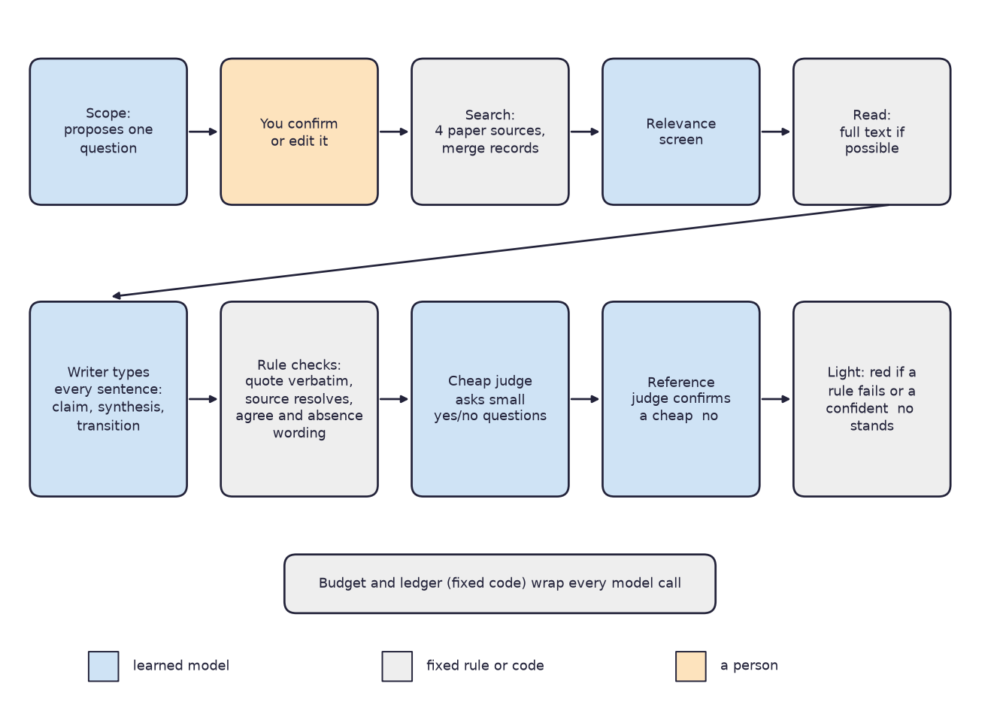
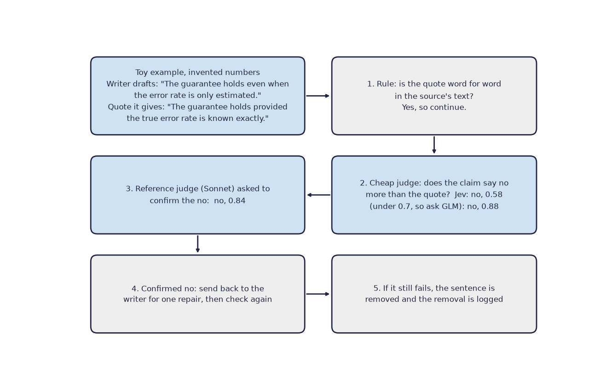
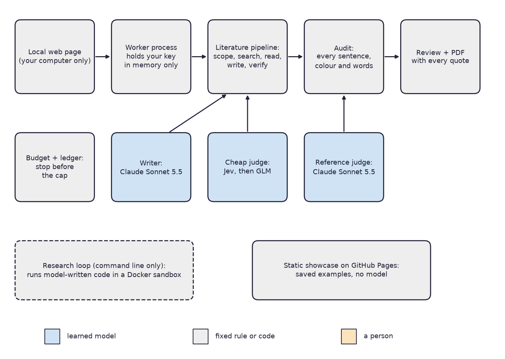
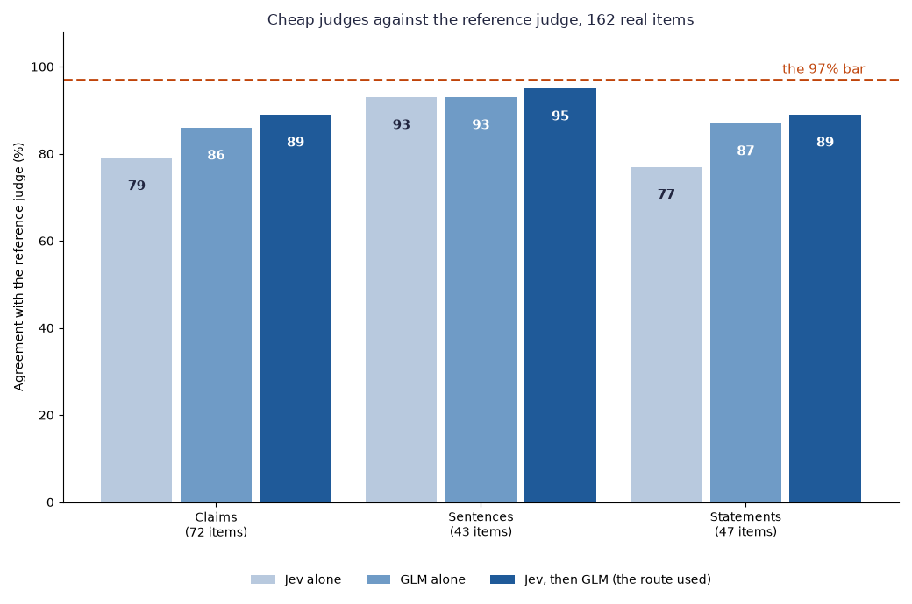
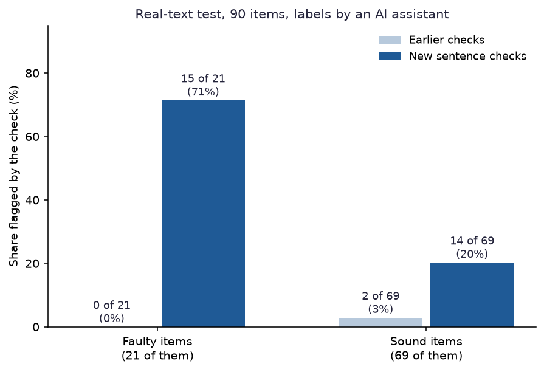

# VERA

*A research assistant that writes a literature review in which each sentence is a quoted claim, a synthesis resting on named quoted claims, or a transition that states no fact, then checks every sentence and says plainly what the check could not show.*

Status: a closed portfolio project, version 1.0, built between 29 September and 15 October 2026, with small showcase additions to 16 October. Code: https://github.com/PCSchmidt/VERA (MIT licence). A read-only showcase of nine finished examples is public at https://pcschmidt.github.io/VERA/.

VERA stands for Verifiable, Economical Research Agents. I built it to test one idea: can an AI research assistant be cheap enough to use and checkable enough to trust? You give it a topic. It proposes one research question and waits for you to confirm it. It searches public paper databases, reads the best papers, and writes a review. Each sentence is one of three kinds. A claim is tied to a word-for-word quote from a source. A synthesis names the claims it rests on. A transition states no fact. Then VERA audits every sentence and shows a colour: green, amber or red. AI coding agents wrote almost all of the code, while I directed the scope, plan, architecture and preferences.

The everyday version: imagine a student assistant who writes up a topic and must highlight, in each source, the exact words behind every claim. A second person, who did not write the draft, reads each claim next to its highlight and asks whether the sentence says more than the highlight does. VERA is that pair, built from software. The assistant is a language model, a program trained on huge amounts of text that writes new text one word-piece at a time. The second person is a cheaper language model backed by a stronger one, plus fixed rules.

Here is what is fixed and what is learned. A calculator is deterministic: the same input always gives the same answer. A weather forecast is probabilistic: a best guess that can be wrong. VERA is a mixture. The fixed parts are the check that a quote appears word for word in its source, the check that a cited paper exists, the rules about wording, the spending limit, the record of every model call and the rule that turns findings into a colour. The learned parts are the language models. They write the review, answer the checking questions and propose the research question. What they do depends on their training, and they can be wrong in ways nobody wrote down. The confidence numbers they give are not guaranteed to be reliable probabilities.

Chance enters in four places. The writer picks its words with some randomness, so two runs on one topic differ. Live searches of paper databases change from day to day. The judges sometimes answer differently when asked the same question twice. And every measurement rests on small samples. To keep chance in check, the checking models are told to answer without random word choice, a hard budget stops a run before it can pass its spending cap, each test set was locked with a file fingerprint before its one test run, and a person confirms the question before money is spent.



The one idea that makes the project work is that the step that writes a sentence is never the step that passes it. Two warnings come before any number. First, the headline result, that the audit caught 50 of 52 faults I planted in papers, was measured on an earlier version of the audit, and 3 of 6 untouched control papers also failed it. Second, only claim sentences are tied to quotes; syntheses and transitions are checked by other rules. Also, stricter checks did not measurably improve the papers, and nobody but me is known to have used the app. If you have ten minutes, read the chapters on what it does, the results, and the strengths and shortcomings.

In short, VERA is a local tool that makes AI-written literature reviews checkable sentence by sentence, and its measurements show that the checking helps, is imperfect, and has not yet been shown to make the writing better.

## What problem this solves

Autonomous research agents can now produce papers that pass automated review. The project's founding document, which I will call the concept document, names two unmet needs. Readers cannot cheaply tell whether an AI-written paper's claims, citations and code hold up. And the cost of such systems puts them out of reach of independent researchers. The system VERA compares itself with, ScientistTwo (a published system that generates research papers automatically), is described in the README as costing about 3,800 dollars and two to three days per task. I could not check that figure, and another line of the same README says its per-run cost is not published.

A concrete version: someone asks an AI for a review of a field and gets fluent paragraphs with citations. A citation can be real while the sentence says more than the paper does. For instance, a paper might say that a medicine reduces risk if it is taken early, and the review might say that it reduces risk. Each sentence sounds fine and cites a real paper, but a reader would have to open the paper to catch the dropped condition. A reader would have to do that for every paper.

VERA's aim is two-sided. It should be cheap: a review cost about 11 to 21 cents and took roughly 7.5 to 15 minutes in the project's runs, on the user's own key (the secret password that lets a program use a paid service). That figure leaves out my own time and the 16.05 dollars spent across the whole project. And it should be checkable: every sentence has a kind, and the audit says what it could and could not confirm. The concept document set four success measures. Catch planted faults; use a cheap judge with little loss in quality; capture a meaningful share of ScientistTwo's gain at a fraction of its cost; and get a new user from topic to useful write-up. At the close the first was met in part, the second for one kind of decision only, the third was not met, and the fourth was never shown.

VERA deliberately does not run in the cloud: the app answers only on the user's own computer and uses the user's own model key. It does not claim to make a complete review, since the search found about 60 percent of the key papers where that was measured, and it does not tell you whether a field's conclusions are right.

This connects to my other work through the idea that a model may propose and fixed checks decide. VERA was also the first full test of Meridian, my framework for building software with AI agents, described in the build chapter. Why not just ask a strong model to check its own review? Because the project's own measurements show models disagree with each other on exactly these questions.

In short, VERA tries to make AI-written reviews both cheap and checkable, and it declines to claim completeness or correctness.

## What it does, step by step

A run has five stages and one person-decision. The user types a topic, optional guidance and a dollar cap. The system turns the topic into one researchable question with a stated reason, and the user confirms or edits it before anything more is spent. It then writes twelve short search queries and sends them to four public paper databases: arXiv (a free archive of research preprints) and Crossref (a registry of published papers' details), which need no key, and OpenAlex and Semantic Scholar (two large search services for papers), which use the user's own keys. A cheap model screens the results for relevance, and the reference lists of the kept papers seed a second round of searching. The best papers are read in full text where a PDF can be turned into text, and by abstract otherwise, and the reading report says which. The writer then drafts the review one sentence at a time and labels each sentence. Every sentence is verified, a failed one is sent back once for repair, and what still fails is removed. Finally an audit re-checks every sentence and returns a colour. On request, a second path writes a longer paper from a finished review, with discussion and conclusions boxed as interpretation, each interpretive statement naming the claims it rests on.

Two ideas need a plain definition before the example. A confidence is the model's own sense of how sure it is, written as a number from 0 to 1: 0.5 is a coin-flip lean, 0.9 is quite sure. And a judge is a model asked one narrow yes-or-no question, such as "Does the claim say only what the quote says?"

Here is one example, a toy with invented numbers but the shape of a real flaw. A source says: "The guarantee holds provided the true error rate is known exactly." The writer produces the claim "The guarantee holds even when the error rate is only estimated", and attaches the source's sentence as its quote. The first check is a plain rule: the quote must appear word for word in the source's text. It does, so the claim goes on. The second check asks a cheap judge named Jev, a small model that returns probabilities. Jev says the claim does not match its quote, but only at 0.58. VERA treats anything under 0.7 as too unsure, so it asks a second cheap judge, a small model called GLM-5.3 Flash, which says no with 0.88. A no on this kind of question is then put to the reference judge, a stronger model (Claude Sonnet 5.5) whose answers serve as the yardstick for the cheaper judges. It also says no, with 0.84. The writer is asked once to repair the sentence. If the repair still fails, the sentence is removed and the removal is logged.



The best everyday comparison is a newspaper with a fact-checking desk that is not allowed to be the writer. The comparison breaks down because a model's confidence is only a number, and because VERA's strongest checker is the same model that wrote the text, like a desk run by the writer's identical twin.

The user sees a plain page: a topic box, live progress and spend, the finished review with each cited sentence dotted, a panel showing the exact quote when a sentence is clicked, the audit result in words, and a PDF download. The user decides the question and the spending cap. Everything else is automatic, and a Stop button halts the run at the next model call, keeping what was done.

Two user stories work today: a student who wants a quoted starting review, and a reader who wants to see whether a sentence is really supported, as the nine showcase examples show. A researcher who wants experiments reproduced and extended is served only partly: that mode exists as a command-line research loop, but it beat the baseline on neither problem it was tried on, and it is not in the app. A green light should not be used as proof that a review is complete or correct. Use in a government or defense setting would need hosting, sign-in, logging and an approved model supply, none of which exists.

In short, a topic goes in, the user confirms one question, and a review comes out with every sentence checked by something that did not write it, and each claim tied to a quote.

## The parts, the data and the rules

The app is a thin layer over the same step-by-step process that the command line uses. A local web page talks to a worker process (a separate program that runs one phase of one run). The worker holds the user's key in memory and nowhere else. The stages hand their work to each other through files in the run's folder. A budget and a ledger sit under every model call; the ledger is a record that is only ever added to, never edited. A second, command-line-only mode runs model-written experiment code in a Docker sandbox, Docker being software that bundles a program with everything it needs and keeps it walled off.



Several rules are enforced in code. The key is accepted only in the body of a request and passed only to the worker. The server answers only requests addressed to the user's own computer and refuses requests from other websites. A model call that might cross the budget cap is refused before it is made, and every call, including a failed one, is written to the ledger. A verdict cannot be issued by the component that produced the text. Model-written code runs only inside the sandbox, with no network.

The data is mostly public papers plus the project's own records. The papers the system reads are abstracts and PDFs retrieved from public databases, stored locally and never committed to the repository, with the web address, date and a file fingerprint recorded for each download. A set of 86 papers generated by ScientistTwo served as evaluation material in an early build stage. The project's test sets are planted-fault papers, real-text items labelled by an AI assistant, and judge-agreement items, each locked by fingerprint before its one test run. And each run leaves its own records: the claims with their quotes (each with a source and a position such as "abstract"), the ledger and the audit report.

Information between steps lives in files and a small checkpoint database, so a stopped or crashed run restarts from its last checkpoint without repeating paid work. The weakest link is retrieval: a review can only be built from papers the search found. At ten or a hundred times more use, the single local machine would break first, because the design is one user on one computer.

In short, the parts are small and separated, the rules protect the key and the budget, and the data is public papers plus the project's own locked test sets.

## The methods and the arithmetic

Most of the thinking in VERA is a handful of simple methods, taken here in the order a sentence meets them.

The first is the word-for-word quote check. A claim must carry a quote, and the quote must appear in its source's text after small adjustments for spacing and capital letters. Quotes shorter than 25 characters never count, because a short phrase proves nothing. A quote that opens with a back-reference such as "However, this patch..." is widened by one earlier sentence from the same passage, since what "this" refers to lies outside it. A string search cannot tell whether the quote means what the claim says; that is the judge's job.

A few wording rules need no model. A sentence that says studies "agree" or "disagree" must rest on claims from at least two different sources. Sentences about what the evidence lacks ("no study examines...") are removed from the evidence sections, because what the search did not find is reported from the run's records instead. A sentence that names a source without a claim behind it ("Smith and colleagues") is removed. These rules are written as English wording patterns, so they catch the phrasings their authors thought of and miss others.

Next comes the confidence rule. Each judge answers one narrow yes-or-no question with a confidence between 0 and 1. The cheapest judge is asked first, and if its confidence is under 0.7 the question goes to one more judge. A judge that errors out counts as zero confidence. In a toy example, the first judge says yes at 0.93, so that stands; another says yes at 0.55, which is under 0.7, so the next judge is asked. On the two harder questions (does a claim say no more than its quote, and does an interpretive statement follow from its claims), a confident cheap no is re-asked of the reference judge before a sentence can fail. If the reference is unsure, below 0.7 either way, the item is reported as "unsettled" and shows as a warning.

The colour is a plain rule. Red means at least one check failed outright: a citation that does not resolve, a quote not in its source, or a confident judge no that stands. Amber means no failure but warnings to read, such as judges disagreeing or an unsettled item. Green means nothing failed and nothing is open.

The budget works like a debit card that checks your balance before the purchase. Before a call, the code adds the call's worst-case price estimate to a copy of the budget. If that would cross the cap, the call is refused and nothing is spent. In a toy example, with a cap of one dollar, 96 cents spent and a next call estimated at 10 cents, the call is refused. After a call, the real cost is charged.

A confidence is useful only if it is reliable: of answers given at "90 percent sure", about nine in ten should be right. The project measures this with ECE (Expected Calibration Error), which groups answers by stated confidence, compares each group's average confidence with how often it was right, and averages the gaps. In a toy example, ten answers each said 0.9 and nine were right, a gap of zero; if only six were right, the gap is 0.3. On the first judge benchmark, Jev's error was 0.008 and GLM's 0.006, which is very good. On the harder claim questions measured later against the reference, Jev's error was 0.14, so the confidences were reliable on easy items and worse on hard ones. A small model run on my own machine reported a confidence of 1.0 on 1,149 of 1,150 answers, so its confidence could never trigger a second opinion.

Every measurement here is a count out of a small total, so a confidence range is given where possible: the span of true rates that a sample of that size could plausibly come from. Fifteen of 21 is 71 percent, but the range runs from about 50 to 86 percent.

In short, none of the arithmetic is exotic: string matching, a few wording rules, a confidence threshold, a budget check and ranges around small counts.

## The models and what they do

VERA uses rented language models and does not train or fine-tune any of them. Most calls go through OpenRouter, a service that sells access to many models under one account and one key. In plain terms there are three: one writer, one cheap checker and one strong checker. The models propose and answer questions; fixed code decides what happens next.

The writer is Claude Sonnet 5.5, a large language model from Anthropic. It proposes the research question, writes the search queries, drafts and repairs the review sentences and writes the longer paper. It is run with some randomness in its word choice, at a sampling temperature of 0.7 (a setting where 0 means always pick the likeliest word and higher values add variety), with minimal extra reasoning. A small comparison of six writer set-ups on the research loop found Sonnet the only one whose experiment code worked first try every time. A cheaper writer for the literature stage was never tried, because a review costs only cents.

The strong checker is the same Claude Sonnet 5.5, used as the reference judge. That is the project's main structural weakness: the model that writes the text also confirms a cheap judge's "no", so the same model is on both sides. The code stops a component from grading its own output, but it compares component names, not models, so the overlap is allowed; the README says so. What the writer gets wrong is the project's main subject, claims that say a little more than their quotes, which independent readers kept finding in documents it had written and the audit had passed.

The cheap checker comes in two parts. Jev, from a company called TypeSafe, is a "decision model": it takes some material and a list of typed questions (true or false, pick an option, score on a scale) and returns a probability for each possible answer instead of prose. That removes the step of reading a written reply, and the confidence is the model's own probability. GLM-5.3 Flash is a small, inexpensive model from the company Z.ai, reached through OpenRouter, answering without random word choice. Jev goes first because it is fast and costs under a hundredth of a cent per item. Anything it answers below 0.7 goes to GLM. For the research loop's questions the notes record why they go straight to GLM: it was right more often, and Jev's few errors were confident ones that a second opinion cannot catch. No recorded reason turned up for the literature stage. In the one cost breakdown I could examine, a showcase review took 219 model calls and 18.5 cents, of which five writer calls made up 17.4 cents and 214 cheap-judge calls about a cent, so writing costs far more than checking. Those are the costs OpenRouter reports, not invoices.

I benchmarked five cheap models before choosing, on 115 easy items such as simple decisions and whether a citation was present. GLM agreed with the answer key 99.8 percent of the time and Jev 97.0. Three other models, DeepSeek V4.1 Flash, MiMo V2.6 Flash and a small Gemma model on my own machine, scored lower, changed their answers on repeated runs more than the 2 percent target allowed, or gave confidence numbers that did not flag their mistakes, so they were dropped. This benchmark measures easy questions, which is why those scores are so high.

The real test used real material: 162 items from five generated papers, with the reference judge's answers as the yardstick. The route VERA uses, Jev and then GLM when unsure, agreed with the reference on 89 percent of claim items, 95 percent of sentence items and 89 percent of statement items. The project's own bar was 97 percent, so none met it. Jev alone scored 79, 93 and 77 percent, and GLM alone 86, 93 and 87. So the 99.8 percent on easy items and the 89 percent on real ones describe the same judges on different difficulty.



Since no route met the bar, I chose to keep Jev then GLM and to have the audit confirm a cheap no with the reference before it can fail. The yardstick is itself soft: the reference gives a different answer on 2 to 6 percent of repeats, is unsure on about a fifth of the claim and statement items, and agrees with an AI assistant's separate labels on 69 percent of claims.

Prompts are text inside the code, versioned only by the change history. The tests use stand-ins for every model call, so they check the plumbing, not model behaviour. A separate program, GROBID (GeneRation Of BIbliographic Data), is run optionally in Docker to turn a paper's PDF into text and a reference list; it is not a language model.

In short, one rented writer, a cheap two-step checker and a strong reference do all the learned work, a fixed router and rules decide what their answers mean, and each model is judged mainly by another model.

## Testing, edge cases and safeguards

An edge case is an unusual situation: a garbled answer, an over-budget call, a request from the wrong place. I tried several against the rules above in a scratch copy (a throwaway copy of the repository). Most were handled. A charge that would cross the cap is refused and nothing is recorded as spent. A call whose worst-case price will not fit is never made. A failed call is logged with its error and zero cost. A garbled judge reply, or a confidence outside 0 to 1, becomes confidence 0 and so asks for a second opinion. A quote changed by one word is rejected, while a case or spacing change still passes; a quote under 25 characters never counts; "the studies agree" resting on one source is flagged; and a request from another website to the local server is refused with no key stored.

Two cases were handled only partly, and they show the weakness of English-pattern rules. "No study examines..." is caught as a sentence about missing evidence, but "No evidence of harm was found" is not. "Smith and colleagues" opening a sentence is caught, but "The Gibbs group" slips past a rule that looks for lowercase wording.

The project has 855 automatic tests that run without internet or paid models; in a scratch copy nearly all passed, and the few skipped need a dataset or Docker that is not in the repository. The tests that matter most assert real behaviour, such as that a call is never made when over budget. One was written from defects found afterwards, so it guards against their return and does not show that new kinds are caught.

The automatic checks on GitHub do not run these tests. The one that runs on every push calls my build framework's verifier, which checks the structure of the framework's checkpoint files and records, and the other publishes the showcase. The framework's own document calls that check the enforcement boundary, which overstates it. Also, four commands in the README's "verify the claims" path misbehave from a clean copy: one stops because its record files are not committed, and three overwrite tracked result files.

Test sets were locked before their one run: file fingerprints are recorded, and two of the project's checks that compare run time with lock time passed when run. The timestamps are the project's own, so an outsider cannot independently verify the order. The audit's own test is the exception, as the opening warned: its 50 of 52 result was measured on an earlier version of the audit, and the project's check now reports that the audit's source changed after the lock.

The biggest thing not tested is whether the judges are right, as opposed to agreeing with each other. No person has labelled the items since the sixth stage of the build. The next biggest is a new person using the app.

In short, the money and key rules are tested and held under attack, the wording rules have gaps, and the checks that matter most were measured against a model rather than a person.

## Does it work? The results

There are five kinds of result, each from one run on a small set. The table gives the headline of each, with what a simple method would score, and the paragraphs below explain the ones that need it.

| What was measured | Result | What a simple method scores | Caveat |
| --- | --- | --- | --- |
| Planted faults caught | 50 of 52 | An audit that passes everything catches 0 | Earlier audit version; 3 of 6 clean control papers also failed |
| Real faulty sentences flagged | 15 of 21 | The earlier checks flagged 0 | Labels from an AI assistant; 14 of 69 sound items also flagged |
| Cheap judges against the reference | 89, 95 and 89 percent | Jev alone 79, 93, 77; GLM alone 86, 93, 87 | Yardstick is a model; the 97 percent bar was not met |
| Key papers found | 59 percent | Not stated | Eight to ten key papers per topic |
| Output quality on a five-point rubric | Mine 4.27, independent scorer 2.93 | Not stated | The scorers disagree; see below |

For the first row, the project planted 52 faults in papers: fabricated citations, altered reference entries, changed qualifiers, altered figures and similar. The audit marked 50 red (96 percent, range 87 to 99 percent). But 3 of 6 untouched control papers also failed, two because the paper really misstated what it reproduced.

For the second row, 90 real items from two of the earlier generated papers were labelled by an AI assistant, 21 as faulty and 69 as sound. The earlier checks flagged none of the 21 and 2 of the 69. The new sentence checks flagged 15 of the 21 (71 percent, range roughly 50 to 86) and 14 of the 69 sound items (20 percent). A flagged sound item is a false alarm, so one in five is a real cost.



Over six topics the search found 34 of 58 key papers, 59 percent, and 64 percent when Semantic Scholar was added. Chance is large at eight to ten key papers per topic: one changed query moves a topic by 10 to 20 points. On the quality rubric, my scores for three reviews averaged 4.27 and an independent scorer's averaged 2.93, with mine at or above theirs on every criterion. For the later papers the averages were 3.94 and 3.17, and both scorers preferred the paper to its review in five of six cases.

What did not work is reported in the project and matters as much. Making the checks stricter did not make papers measurably better: two papers remade under the stricter rule went from 0 to 1 and from 1 to 2 failures, one run each. Earlier, an independent reader found about as many overstated claims in the seventh stage's papers (four and five per paper, against three to six before). Re-audited under the new checks, the first three generated papers all turned from green to red. The research loop did not beat the baseline on either problem it was given, and the comparison with ScientistTwo was not met. A new user completing a run was never shown; the one walkthrough was mine.

For the headline numbers above, the committed result files match what the README states, and the documents overstate in a few places listed in the shortcomings chapter.

In short, the checks catch most planted and many real faults, but no cheap judge met its bar and stricter checking has not yet been shown to improve the papers.

## Could it be put into real use?

VERA has never been operated for real users. It runs on my own machine, by design, and the only public part is a static showcase that replays saved examples and runs no model. GitHub shows no stars or forks, and no issues or pull requests; the traffic page shows no views in the last two weeks, and clone counts that I cannot attribute. A project can sit on a ladder with four rungs: an experiment, something that works locally, something deployable, and something operated. VERA is on the second rung: it runs and passes its tests on one machine.

Against the usual production habits, the picture is mixed. Someone else can nearly run it from a clean start, with software versions locked, though the plain install strips packages the tests need. The automatic checks do not block a bad change because they do not run the tests. Quality is measured against baselines, with the caveats above. Budgets stop runs, runs resume from checkpoints and failed calls are logged. A person confirms the question and can press Stop, but nobody reviews the sentences before the light appears. The ledger can diagnose cost and failures, but there is no monitoring or alerting. The user's key is never stored; a pattern scan found no key in the files or history, and GitHub's secret scanning and push protection are on, while Dependabot security updates and branch protection are off.

What mirrors real practice: a spending cap that raises before a limit is crossed, a ledger of every call, test sets locked before their one run, an independent evaluator that failed four of eleven first-round reviews, and open reporting of misses.

To deploy it for others, it would need hosting, which conflicts with the local-only design I chose, plus sign-in, monitoring, a way to roll back a bad release, pinned model versions, a security review and a runbook (a written guide for whoever keeps it running). Three steps that one person could do: make the automatic checks run the tests and fail on a break, get an outside person to run the walkthrough and write down what went wrong, and have a person label a sample to replace the model as yardstick. As a showcase it is possible, not strong: very good on evaluation habits and open reporting, weak on deployment, and it was built to stay local.

In short, VERA works locally and as a public replay of saved examples, and it should not be described as operated.

## Strengths, shortcomings and the work still to do

The strongest thing about the project is how it treats its own results. It reports negative findings plainly, measures each check against an earlier baseline, locks test sets before running them, and keeps an independent evaluator's verdicts, including four failures. The budget, the ledger and the key handling held up when attacked.

The main shortcomings are gaps. The yardstick is a model, not a person: the reference judge is the writer's own model, is unsure on about a fifth of its verdicts on the two harder question kinds, and the labels behind the real-text test came from an AI assistant. Stricter checking has not been shown to improve papers, and one run per paper cannot separate a real change from ordinary run-to-run variation. The samples are small. A new person has never used it. Retrieval misses about two in five key papers. The wording rules are English patterns with holes, and the planted-fault result belongs to an earlier audit.

Four statements in the project's documents overstate what was built. The GitHub description advertises an auditor of papers' code and novelty, which was never built for outside papers. The README says the cheap judge answers every check first, but the literature questions skip Jev. The framework calls its automatic check an enforcement boundary. And the verify path fails or overwrites files. None changes the measured results, but a reader relying on them would be misled.

Two process records need a plain note. Two human approvals in the seventh build stage were actually done by an AI assistant working in my terminal; the review says so, but the checkpoint record names me. And a checkpoint asking for "a person other than the builder" passed with the builder, which the review also discloses.

The promised app, judge router, literature pipeline, sentence checks, audit, ledger and showcase are done and tested. The research loop exists but beat no baseline and is command-line only. Not built, and listed with reasons in the closing plan: auditing other people's papers, experiments from the app and the planned portfolio papers. The top three improvements are making the automatic checks run the tests, getting a person's labels for a sample, and having one outside person try it; the labels would most raise a reader's confidence in the numbers. The plan is closed, and it looks worth tidying, not extending.

In short, the project is mostly sound and its weaknesses are mostly written down, and the best next steps are small repairs and one outside user.

## How it was built, and who did what

AI coding agents wrote almost all of the code, and I directed the scope, plan, architecture and preferences. Commit credits name Claude Sonnet 5.5 on 140 of 241 commits and Claude Opus 5.5 on 77, and the README says it was built with Claude Code. Twenty-four commits carry no credit. An OpenAI assistant, recorded as ChatGPT or Codex, did specific steps at my request in the seventh and eighth build stages: labelling test items, running re-audits and first rubric scores. I also commissioned an outside review of one paper from ChatGPT.

I built VERA in ten numbered stages that the project calls increments, each ending at a gate. A gate is a checkpoint that must be passed, sometimes with my written approval, before the next stage begins. The decisions that the records show as mine: the direction (a topic in, a paper-shaped write-up out, through a local app with the user's own key), the 20-dollar monthly spending ceiling, each design trade-off decided in writing, the choice to keep Jev then GLM when no route met the bar, the decision to close the project, and the human gate approvals (43 recorded under my name, two of them actually run by an assistant).

The work was checked through Meridian, my framework for AI-built software: a map of 89 gates, 43 requiring a person's approval, and an evaluator agent (an AI that did not write the work) that scores each stage's review. Four of eleven first-round reviews failed (scores 6.2, 6.2, 6.0 and 5.5), and one failure caught a wrong headline. The log also records four "escapes", things the framework should have blocked. The first five stages landed in many small commits, but stages 6 to 10 landed in one or two very large commits each, so their step-by-step history is not recoverable.

In short, the agents typed and I steered and approved, and the evaluator's failed rounds show the checking could say no.

## For recruiters and interviewers

**In thirty seconds.** I directed AI coding agents to build VERA, a local tool that writes a literature review with every claim tied to a quote, checks each sentence with cheap models backed by a stronger one, and reports how well that works, including where it falls short. **In two minutes**, add that the audit caught 50 of 52 planted faults on an earlier version, that no cheap checker met its agreement bar, that stricter checks did not improve the papers, and that nobody but me has used it.

**What it demonstrates.** Evaluation habits, safety thinking (hard budgets, key handling, a component never grading itself), model routing under cost, and directing AI agents through a gated process. It does not demonstrate operating a service, working on a team, scale, being on call or building from scratch live.

| Typical requirement | Strength | How to say it |
| --- | --- | --- |
| Multi-step language-model workflow (search, read, write, verify, audit) | Demonstrated, locally | "I built and measured it; it is not hosted." |
| Evaluation of model output | Demonstrated | "The yardstick is a model; I would add human labels." |
| Choosing models and trade-offs | Demonstrated | "I chose on measured agreement, cost and speed." |
| Human-in-the-loop control | Partly | "A real gate at the start, none on the output." |
| Deployment and monitoring | Simulated | "Never operated; no alerting." |
| Working with customers | Not shown | "A single-builder project." |

The strongest role family is the applied language-model and multi-step workflow engineer. The weakest is the machine-learning engineer with deployment and monitoring work, since nothing is trained or monitored in production.

**Four likely questions.**
1. *The hardest problem?* The records point to this: a green audit that independent readers kept finding wrong. Each new layer made the light more accurate but did not measurably improve the writing.
2. *A decision that turned out wrong?* The ninth stage's review first called the remade papers better on an unfair comparison, and the independent evaluator failed it. The first three generated papers also audited green and then turned red under stricter checks.
3. *How do you know it works?* I don't fully. Planted faults are caught, but the real-text labels came from an AI assistant and the judges fall below my own bar.
4. *How did you use AI tools without losing control?* A written plan, evaluator verdicts kept as written, locked test sets and human approval gates.

**Three tough questions.** *Isn't this a wrapper around AI services?* Largely yes: every model is rented. The project's own work is the routing, rules, budget, audit and measurements. *If agents wrote the code, what did you do?* Set scope, decided trade-offs, approved gates, and judged results. *Why believe the numbers?* The result files match, and the caveats are written down; see the results chapter.

**What not to exaggerate.** It is a research project and a local tool, not a product. The checks are measured against models. I did not write the code by hand.

In short, the project shows careful evaluation with AI-directed engineering, and it does not show operating a service.

## Glossary

- **Audit light:** green, amber or red for a document, red if any check fails outright.
- **Calibration:** whether a model's stated confidence matches how often it is right.
- **Claim, synthesis, transition:** the three sentence kinds: tied to a quote, built on named claims, or stating no fact.
- **Confidence:** a model's own sense of how sure it is, from 0 to 1.
- **ECE (Expected Calibration Error):** how far a model's stated confidence is, on average, from how often it is right.
- **Evaluator:** an AI agent that did not write the work and scores its review.
- **Gate:** a checkpoint in the build that must be passed, sometimes with my approval, before the next stage starts.
- **GLM-5.3 Flash:** a small, cheap language model from Z.ai, the second cheap judge.
- **GROBID (GeneRation Of BIbliographic Data):** a program that reads a PDF into text and references.
- **Increment:** one of the ten numbered stages of the build.
- **Jev:** TypeSafe's decision model that returns probabilities instead of prose; the first cheap judge.
- **Ledger:** the append-only record of every model call and its cost.
- **Meridian:** my framework of gates for AI-built software.
- **OpenRouter:** a service that sells access to many language models under one key.
- **Paper databases:** arXiv (free preprint archive), Crossref (registry of published papers), OpenAlex and Semantic Scholar (large paper-search services).
- **Reference judge:** Claude Sonnet 5.5 used as the yardstick and confirmer.
- **ScientistTwo:** a published system that writes research papers automatically, VERA's comparison point.
- **Temperature:** a setting for how random a model's word choice is; 0 means the likeliest word every time.
- **Token:** a small chunk of text, the unit in which models are priced.
- **Unsettled:** the reference judge was unsure either way.

## Where to look in the code

This list is for engineers; other readers can stop here.

```
VERA/
  vera/         the package: app, audit, backends, judge, ledger, literature, loop, sandbox, schemas
  tests/        855 offline tests with stand-in models
  tools/checks/ gate checks that run from the build framework
  scripts/      measurement and build scripts, plus one-line gate wrappers
  data/         topics, run records, frozen test sets and results
  docs/         plan, requirements, trade studies, reviews (one per increment)
  docker/       sandbox images for the research loop
  .meridian/    the 89 gates, approvals and evaluator verdicts
```

The app starts from `vera/app/server.py` (the `vera-app` command). Install with `uv sync --group dev --group bench --group corpus`, then `uv run pytest -q`. Five files to read first: `vera/ledger/__init__.py`, `vera/judge/cheap_path.py`, `vera/literature/synthesis_stage.py`, `vera/literature/sentence_checks.py` and `docs/reviews/retrospective.md`.
